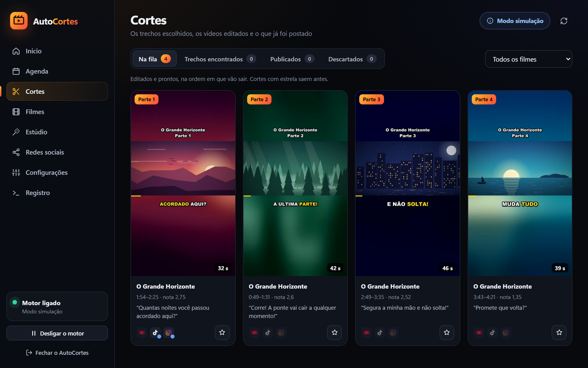
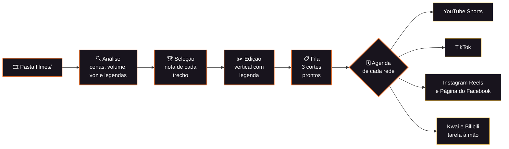
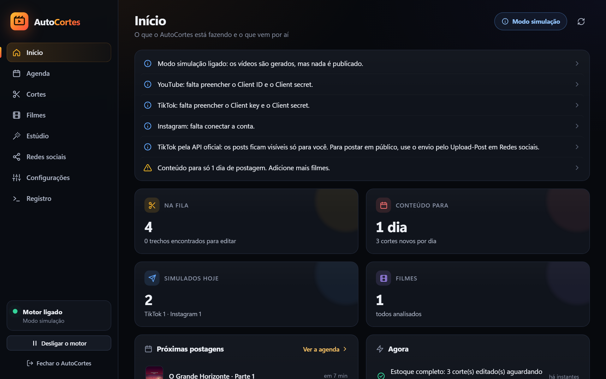
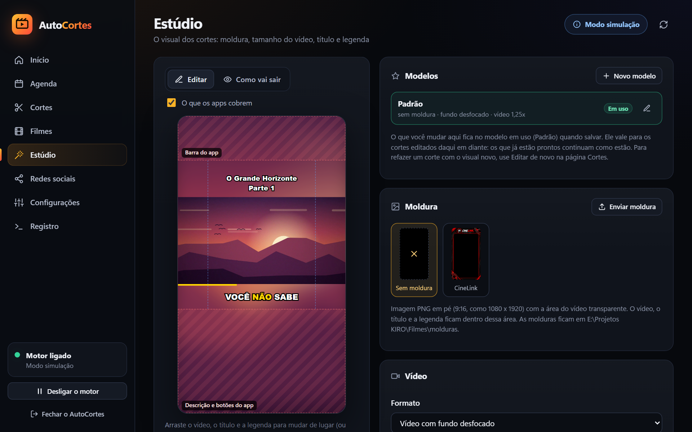
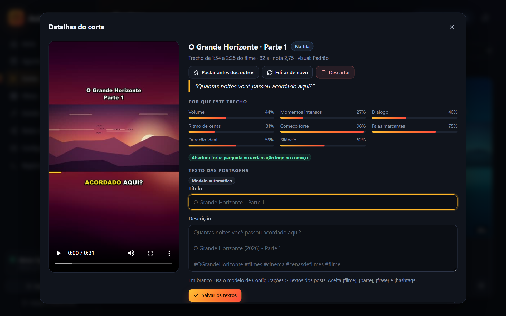
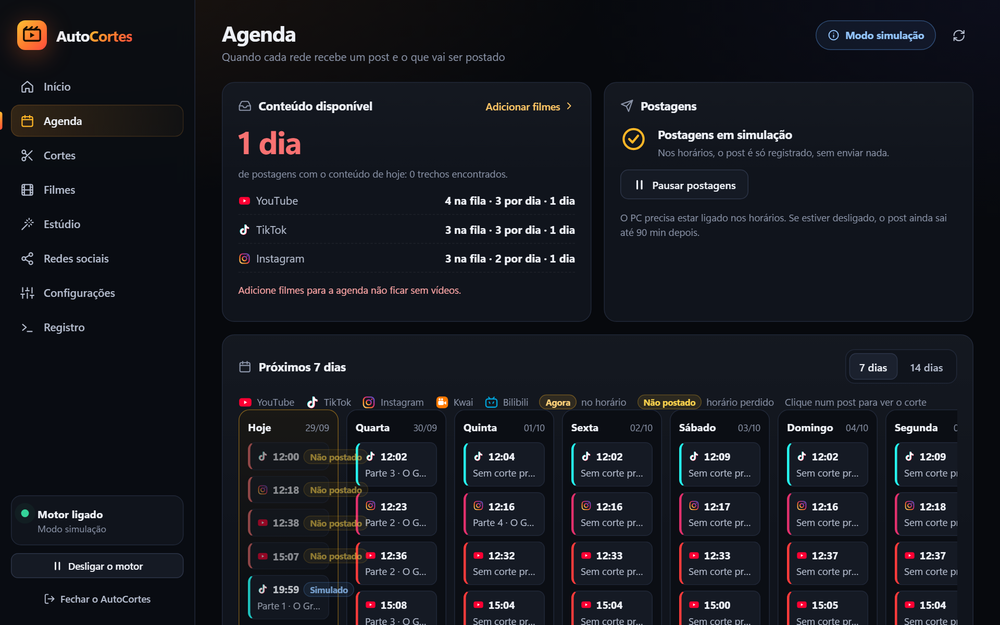

<div align="center">


<br>

**Corta filmes em vídeos verticais com legenda palavra por palavra e posta sozinho, na agenda de cada rede.**<br>
Roda no seu PC com Windows, com FFmpeg e whisper.cpp. Os vídeos só saem do computador para as redes que você conectar.

[](https://www.python.org/downloads/)
[](https://ffmpeg.org/)
[](https://github.com/ggml-org/whisper.cpp)
[](https://sqlite.org/)
[](#passo-a-passo-instalar-e-usar)
[](#situação-atual)

**[Passo a passo](#passo-a-passo-instalar-e-usar)** · [Como funciona](#como-funciona) · [Painel](#painel) · [Redes sociais](#redes-sociais) · [Agenda](#agenda-de-postagens) · [Configuração](#configuração) · [Próximos passos](#pendências-e-próximos-passos)

</div>

<br>

<p align="center">
  
</p>
<p align="center"><sub>A página Cortes do painel. O filme de exemplo foi gerado só para estas imagens: ilustrações, voz sintetizada do Windows e legenda própria.</sub></p>

## O que é

O AutoCortes corta filmes, edita em formato vertical e publica sozinho no **YouTube Shorts**, **TikTok** e **Instagram Reels** (e, se você quiser, na **Página do Facebook** junto com o Instagram), em loop e seguindo uma agenda. No **Kwai** e no **Bilibili**, que não têm API de postagem aberta, ele prepara cada post e você publica pelo app ou pelo site. Você coloca os filmes numa pasta; o sistema analisa cada um, escolhe os melhores trechos, edita com legenda palavra por palavra e posta nos horários de cada rede, sempre com alguns vídeos prontos na fila.

Tudo roda no seu PC com Windows, usando FFmpeg e whisper.cpp. Os vídeos só saem do computador para as redes que você conectar. Para instalar do zero, inclusive a IA local com o Ollama, siga o [passo a passo](#passo-a-passo-instalar-e-usar).

> [!WARNING]
> Cortes de filmes protegidos geram Content ID, strikes e bloqueio de conta, e as redes tratam trecho de filme com pouca edição como conteúdo não original. Use filmes em domínio público, Creative Commons, próprios ou licenciados. Detalhes em [Direitos autorais e originalidade](#direitos-autorais-e-originalidade).

<table>
<tr>
<td width="33%" valign="top">

**🎬 Escolhe os melhores trechos**<br>
Cada trecho de 30 a 60 s ganha nota por volume, picos, diálogo, ritmo de cenas e começo forte. O corte começa e termina numa troca de cena ou numa pausa da fala.

</td>
<td width="33%" valign="top">

**💬 Legenda palavra por palavra**<br>
Transcrição com o whisper.cpp no seu PC, cada palavra encaixada na voz detectada e destaque amarelo na palavra que está sendo dita.

</td>
<td width="33%" valign="top">

**📱 Vertical pronto para postar**<br>
1080x1920 com fundo desfocado ou moldura, nome do filme e "Parte N" no topo, barra de progresso, final suave e áudio em -14 LUFS. O primeiro quadro já sai com imagem, porque ele vira a capa do post.

</td>
</tr>
<tr>
<td valign="top">

**🗓️ Agenda por rede**<br>
Horários e dias próprios em cada rede, com variação aleatória, intervalo mínimo e limite de posts por dia.

</td>
<td valign="top">

**🔁 Loop sem parar**<br>
Mantém 3 cortes prontos à frente das postagens e volta aos filmes já analisados quando acabam os novos.

</td>
<td valign="top">

**🖥️ Painel no navegador**<br>
10 telas, com o Estúdio para ajustar o visual numa tela de celular, o calendário da semana e o registro ao vivo.

</td>
</tr>
<tr>
<td valign="top">

**✋ Postagem à mão quando não há API**<br>
No Kwai e no Bilibili, cada horário vira uma tarefa com o vídeo e os textos no formato da rede. Você posta e marca "Já postei".

</td>
<td valign="top">

**🤖 IA opcional e local**<br>
Título, descrição e hashtags escritos pelo Ollama no seu PC, ou por qualquer API compatível com a da OpenAI.

</td>
<td valign="top">

**🔒 Seu PC, suas contas**<br>
Painel só em 127.0.0.1, com token por sessão, e logins das redes cifrados com a proteção de dados do Windows.

</td>
</tr>
</table>

## Como funciona



1. **Pasta de filmes.** A cada 5 min o sistema procura vídeos novos em `filmes/` (mp4, mkv, avi, mov, webm, ts e outros). Título e ano saem do nome do arquivo: `O.Poderoso.Chefao.1972.1080p.BluRay.mkv` vira "O Poderoso Chefao", de 1972. Episódio de série (`S01E01` ou `1x01`) vira "Nome T1:E1".
2. **Análise**, uma vez por filme e com cache (se parar no meio, continua de onde estava):
   - tarjas pretas, trocas de cena, volume a cada 0,5 s e trechos com voz;
   - legendas: `.srt` ao lado do filme, senão a legenda embutida (de texto), senão transcrição com Whisper. Em arquivo com áudio dublado ("Dual", com dois idiomas, ou "Dublado" no nome), a legenda embutida costuma ser a tradução do original e não bate com a dublagem, então a fala dublada é transcrita; se a transcrição falhar, a legenda embutida entra no lugar. Uma faixa com poucas falas para o filme (só os letreiros, mesmo sem a marca "forced") é pulada, e entre duas faixas em português a do Brasil vem antes;
   - pula a abertura e os créditos finais (até 90 s no início e 7 min no fim).
3. **Seleção.** Cada trecho de 30 a 60 s recebe uma nota: volume, picos de intensidade, diálogo, ritmo de cenas, começo forte, falas com ! e ? e palavras-chave. Perde nota o corte que abre com "então", "mas" ou "aí", ou que pega uma frase pela metade. O corte começa e termina numa troca de cena ou numa pausa da fala. São até 40 cortes por filme, sem sobreposição.
4. **Edição.** Vídeo 1080x1920 com o visual do modelo em uso (veja [Estúdio](#painel), abaixo): moldura opcional por cima, filme no centro sobre fundo desfocado ou preto (ou preenchendo a área), legenda palavra por palavra com destaque amarelo, nome do filme e "Parte N" no topo, barra de progresso, fade e áudio normalizado em -14 LUFS. Por padrão, título e legenda ficam na área que os apps não cobrem e diminuem sozinhos quando o texto é comprido. A legenda não separa palavras que andam juntas: "PARA A CASA" sai inteiro, nunca "VOU PARA / A CASA".
5. **Aprovação (opcional).** Com `exigir_aprovacao = true`, cada corte editado espera você aprovar antes de entrar na fila.
6. **Publicação.** No horário de cada rede, o próximo corte da fila sai com título, descrição e hashtags montados por modelo, ou escritos pela IA, se ela estiver ligada. O mesmo corte vai para todas as redes ativas, cada uma no seu horário e com o mesmo texto. Nas redes à mão, o horário vira uma tarefa no Início (veja [Postagem à mão](#postagem-à-mão-kwai-bilibili-e-qualquer-rede)).
7. **Loop.** O sistema mantém 3 cortes editados à frente das postagens. Quando acabam os filmes novos, volta aos já analisados e procura trechos ainda não usados; quando não sobra nada, avisa para você adicionar filmes.

> [!TIP]
> O **modo simulação** vem ligado: gera todos os vídeos, mas não envia nada, e o registro mostra o que teria sido postado.

## Situação atual

Atualizado em outubro de 2026.

| Parte | Situação |
|---|---|
| Análise dos filmes e escolha dos trechos | ✅ Pronta e testada |
| Edição vertical (legenda, título, barra, áudio) | ✅ Pronta e testada |
| Envio para YouTube, TikTok e Instagram pela API oficial | 🧪 Pronto; testado contra um servidor simulado, ainda não nas APIs reais |
| Envio pelo Upload-Post (opcional, por rede) | 🧪 Pronto; testado contra um servidor simulado, ainda não no serviço real |
| Envio pelo seu navegador (YouTube, TikTok, Instagram, Bilibili) | ✅ Em uso de verdade desde outubro de 2026 no YouTube, no TikTok e no Instagram; o Bilibili ainda não foi validado com a conta logada |
| "Aprender a postar": grava o roteiro enquanto você posta à mão | ⚠️ Pronto e testado com o Chrome real; a gravação de cada rede depende da conta logada |
| Roteiro como linguagem simples, editável no painel | ✅ Pronto e testado |
| Roteiros padrão do YouTube, TikTok e Instagram, que vêm com a instalação | ✅ Tirados dos roteiros que postaram de verdade em outubro de 2026 |
| Instagram também na Página do Facebook (opcional) | 🧪 Pronto, pela API oficial e pelo Upload-Post; testado contra um servidor simulado |
| Kwai, Bilibili e postagem à mão em qualquer rede | ✅ Pronto e testado: tarefas no Início com vídeo, textos por rede, "Já postei" e pasta sincronizada |
| YouTube só com Shorts (vertical ou quadrado, até o limite de duração) | ✅ Pronto e testado |
| Agenda por rede, fila e planejador | ✅ Pronto e testado de ponta a ponta em simulação |
| Painel no navegador (10 telas, API local com 81 rotas) | ✅ Pronto e testado no Edge |
| Canais do YouTube: baixa sozinho os vídeos novos para a pasta de filmes | ✅ Pronto e testado (o yt-dlp de verdade num canal público; as regras e a fila, com um yt-dlp falso) |
| Atualização pelo GitHub a cada 2 dias, com tudo parado | ✅ Pronta e testada: o ciclo inteiro com um repositório local (fecha, troca, abre de novo com os perfis e volta sozinha se a versão nova não abrir), e o clone e o ZIP contra o GitHub de verdade |
| Perfis de nicho: vários nichos na mesma instalação, cada um com suas contas | ✅ Pronto e testado (dois perfis abertos ao mesmo tempo, de verdade) |
| Vídeos criados do zero: narração, imagens de fundo e legenda no tempo da voz | ✅ Pronto e testado de ponta a ponta (narração no serviço real) |
| Pauta escrita à mão (`pautas/*.txt`) | ✅ Pronta e testada |
| IA escrevendo a pauta, fila de temas e vídeo criado entrando na agenda | ✅ Pronto e testado com o Ollama de verdade (tema → roteiro → vídeo → fila → post) |
| Tela Criação no painel (pautas, fila de temas, editor e criar na hora) | ✅ Pronta e testada no Edge |
| Moldura, modelos visuais e aba Estúdio | ✅ Prontos; testados com o episódio de The Great e conferidos quadro a quadro |
| IA opcional para título, descrição e hashtags | ✅ Pronta e testada com o Ollama de verdade (qwen3 4B, uns 4 s por corte numa Radeon RX 5500 XT) |
| Métricas dos posts (YouTube e Instagram) | 🧪 Prontas; testadas contra um servidor simulado |
| `AutoCortes.bat`, `AutoCortes.pyw` e "Iniciar com o Windows" | ✅ Prontos e testados |

✅ pronto e testado · 🧪 pronto, testado só contra um servidor simulado

Pelo navegador, o AutoCortes já posta de verdade no YouTube, no TikTok e no Instagram. Pelas APIs oficiais e pelo Upload-Post, ainda falta a primeira postagem real: foram testados contra servidores simulados.

## Passo a passo: instalar e usar

O AutoCortes roda no seu PC: o GitHub só guarda o código. Do zero, a instalação leva uns 15 minutos. O que ele precisa depois (whisper.cpp, modelo de transcrição, yt-dlp) ele baixa sozinho e confere pelo SHA-256.

Você vai precisar de:
- Windows 10 ou 11, 64 bits
- internet na primeira vez
- espaço em disco para os filmes e os cortes (o AutoCortes e o modelo de transcrição ocupam menos de 1 GB, e a IA, se você usar, mais uns 7 GB)
- contas nas redes onde vai postar

### 1. Instale o Python

1. Em [python.org/downloads/windows](https://www.python.org/downloads/windows/), baixe o **Windows installer (64-bit)** do Python 3.14. O AutoCortes pede a 3.11 ou mais nova e foi testado na 3.14.
2. Na primeira tela do instalador, marque **Add python.exe to PATH** e clique em **Install Now**.
3. Para conferir, abra o PowerShell (tecla Windows, digite `PowerShell` e tecle Enter) e rode `python --version`. Tem que aparecer `Python 3.14`.

O site também oferece o **Python install manager**, que agora é o recomendado por lá. Se instalar por ele, rode `py install 3.14` no PowerShell depois.

### 2. Instale o FFmpeg

No PowerShell:

```powershell
winget install Gyan.FFmpeg
```

Feche o PowerShell, abra de novo e confira com `ffmpeg -version`.

Sem o `winget`, baixe o "full build" em [gyan.dev/ffmpeg/builds](https://www.gyan.dev/ffmpeg/builds/) e extraia, por exemplo, em `C:\ffmpeg`. Depois de abrir o AutoCortes (passo 4), informe `C:\ffmpeg\bin\ffmpeg.exe` e `C:\ffmpeg\bin\ffprobe.exe` em Configurações > Sistema > Ferramentas.

### 3. Baixe o AutoCortes

Escolha uma pasta **fora do OneDrive** e com espaço livre, como `C:\AutoCortes` ou `D:\AutoCortes`. É nela que ficam os filmes, os cortes e o banco, e uma pasta sincronizada atrapalha o banco e enche a nuvem de vídeo.

- **Com o Git** (se não tiver, instale com `winget install Git.Git` e abra o PowerShell de novo):
  ```powershell
  git clone https://github.com/irwagner/autocortes.git C:\AutoCortes
  ```
- **Sem o Git:** no GitHub, clique no botão verde **Code > Download ZIP** e extraia o ZIP. Depois mova a pasta que tem o `AutoCortes.bat` dentro (ela vem como `autocortes-main`) para a pasta escolhida; pode renomear. Não rode nada de dentro do ZIP sem extrair.

Os dois jeitos recebem as [atualizações automáticas](#atualização-automática).

### 4. Abra pela primeira vez

1. Na pasta do AutoCortes, dê dois cliques no **`AutoCortes.bat`**. Se o Windows avisar que o arquivo veio da internet, clique em **Mais informações > Executar assim mesmo** (ou em **Executar**).
2. Na primeira vez, a janela preta prepara o Python e instala as bibliotecas, o que leva um ou dois minutos. Depois o painel abre no navegador, em `http://127.0.0.1:8777`.
3. Deixe a janela preta aberta: fechar a janela desliga o AutoCortes. Se fechar a aba do navegador, dois cliques no `.bat` abrem o painel de novo.

Ele começa em **modo simulação**: analisa, edita e segue a agenda, mas não publica nada até você ativar (passo 8).

### 5. Coloque os filmes

- Copie os vídeos para a pasta `filmes`, dentro da pasta do AutoCortes, ou arraste para a tela **Filmes** do painel. Uma legenda `.srt` com o mesmo nome do vídeo (`Filme.srt` ou `Filme.pt-BR.srt`) vai junto e poupa a transcrição.
- Ou cadastre canais do YouTube em **Filmes > Canais do YouTube**, e os vídeos novos deles chegam sozinhos ([veja como](#canais-do-youtube)).
- Use só o que você pode postar: filmes em domínio público, Creative Commons, próprios ou licenciados ([por quê](#direitos-autorais-e-originalidade)).

Na primeira análise, o AutoCortes baixa o whisper.cpp e o modelo de transcrição (uns 500 MB). Cada filme é analisado uma vez, e os cortes aparecem em **Cortes**. O visual (moldura, tamanho do vídeo, fonte e cores) se ajusta no **Estúdio**, e os horários de cada rede, na **Agenda**.

### 6. Ligue a IA com o Ollama (opcional)

Sem IA, o título, a descrição e as hashtags saem dos modelos de Configurações > Textos dos posts. Com ela, cada corte ganha textos escritos a partir da fala do trecho, e a tela **Criação** escreve pautas a partir de um tema. Tudo roda no seu PC.

1. Baixe o Ollama em [ollama.com/download](https://ollama.com/download) e instale. Não precisa ser administrador; ele pede o Windows 10 22H2 ou mais novo e uns 4 GB no disco, fora o modelo.
2. No PowerShell, baixe o modelo (2,5 GB):
   ```powershell
   ollama pull qwen3:4b-instruct-2507-q4_K_M
   ```
   Confira com `ollama list`: o modelo tem que aparecer na lista.
3. Deixe o Ollama aberto. Ele fica em segundo plano, com um ícone perto do relógio, e atende em `http://127.0.0.1:11434`.
4. No painel, em **Configurações > IA**, ligue **Escrever os textos com IA**, clique em **Testar a IA** e salve na barra do rodapé.

Dicas:
- **C: cheio?** No lugar do passo 1, instale o Ollama em outro disco e guarde os modelos fora do C: com a variável `OLLAMA_MODELS`, antes do `ollama pull`. No PowerShell, na pasta onde o instalador foi baixado:
  ```powershell
  cd $HOME\Downloads
  .\OllamaSetup.exe /DIR="D:\Ollama"
  setx OLLAMA_MODELS "D:\Ollama\modelos"
  ```
  Quando a instalação terminar, feche o Ollama pelo ícone perto do relógio e abra de novo pelo menu Iniciar, para ele usar a pasta nova dos modelos.
- **Placa de vídeo:** com NVIDIA, deixe o driver atualizado; com AMD, o Ollama usa a placa pelo Vulkan (ou pelo ROCm, nas placas que têm). Sem placa dedicada, ele roda no processador: fica mais devagar, mas funciona, porque os textos são feitos em segundo plano.
- **Modelo maior:** a aba IA mostra a memória da sua placa e o comando do maior modelo que cabe nela ([tabela](#ia-para-os-textos-opcional)).
- **No lugar do Ollama:** o LM Studio (`http://127.0.0.1:1234/v1`) ou uma API online também servem. Numa API online, a fala de cada trecho sai do seu PC.

Mais sobre o Ollama no Windows na [documentação oficial](https://docs.ollama.com/windows).

### 7. Conecte as redes

Em **Redes sociais**, escolha a **Forma de envio** de cada rede:

| Forma | Como funciona | Bom saber |
|---|---|---|
| API oficial | Você cria as chaves no site de desenvolvedor da rede e conecta a conta. O painel tem o passo a passo de cada uma | No TikTok, sem a auditoria do app, os posts ficam visíveis só para você |
| Upload-Post (pago) | Um serviço que já tem a aprovação das redes; você cola a chave dele | Posta em público no TikTok, mas o TikTok não está no plano grátis |
| Navegador (arriscado) | O AutoCortes abre o Chrome (ou o Edge) num perfil separado, você entra na conta uma vez, e ele preenche a página de envio com os roteiros que vêm prontos | Contraria os termos das redes e pode custar a conta: use numa conta que você pode perder |
| À mão (pelo app) | Cada horário vira uma tarefa no Início, com o vídeo e os textos; você posta e marca "Já postei" | O jeito do Kwai e do Bilibili, e de quem prefere postar pelo celular |

Depois de conectar, clique em **Testar** (no navegador, **Testar a sessão**). Os detalhes de cada rede estão em [Redes sociais](#redes-sociais).

### 8. Ative a publicação real

Com as redes testadas, clique em **Ativar a publicação real**, no topo de Redes sociais. A partir daí, cada rede ativa recebe o próximo corte da fila nos horários da Agenda.

### 9. No dia a dia

- **Deixe aberto:** os posts só saem com o AutoCortes aberto. Em Configurações > Sistema, ligue **Iniciar com o Windows** para ele abrir sozinho quando você entra no Windows, em segundo plano, sem janela e sem abrir o navegador (para ver o painel, abra o `.bat`).
- **Atualizações:** a cada 2 dias ele confere o GitHub e se atualiza sozinho, quando nada estiver rodando ([como funciona](#atualização-automática)).
- **Fechar:** use **Fechar o AutoCortes**, na lateral do painel.
- **O que aconteceu:** a tela **Registro** mostra tudo ao vivo, e o arquivo fica em `dados\logs\autocortes.log`.

### Se algo der errado

| O que aparece | O que fazer |
|---|---|
| "Não encontrei o Python" | Instale o Python marcando "Add python.exe to PATH" (passo 1) e abra o `.bat` de novo |
| "A pasta .venv foi criada com um Python antigo" | Apague a pasta `.venv`, dentro da pasta do AutoCortes, e abra o `.bat` de novo. Ela é refeita, e nada do AutoCortes se perde |
| "Não consegui instalar as bibliotecas" | Confira a internet. Se continuar, apague a pasta `.venv` e abra o `.bat` de novo |
| "O FFmpeg não está no PATH" | Instale o FFmpeg (passo 2) e abra o `.bat` de novo, ou informe o caminho em Configurações > Sistema |
| "Não consegui abrir a porta 8777" | Outro programa usa a porta: troque `porta`, em `[painel]`, no `config.toml` da pasta do AutoCortes |
| O painel não abriu no navegador | Abra `http://127.0.0.1:8777` à mão |
| "Testar a IA" falha | Confira se o Ollama está aberto (ícone perto do relógio) e se o modelo do painel tem o mesmo nome que aparece no `ollama list` |

### Mais sobre a abertura

Na primeira vez, o `AutoCortes.bat` cria o ambiente do Python (a pasta `.venv`), instala as bibliotecas e cria o `config.toml` a partir do `config.example.toml`; depois abre o painel já com o motor ligado. Se o AutoCortes já estiver aberto, o `.bat` só abre o painel de novo. Quando o `requirements.txt` muda, ele instala as bibliotecas de novo sozinho; se a `.venv` vier de um Python antigo (ou o Python dela tiver sido desinstalado), ele avisa para apagar a pasta. Se algo impedir a abertura pelo "Iniciar com o Windows", aparece uma caixa com o motivo.

Com o AutoCortes aberto, os comandos do terminal que editam, criam ou postam (`analisar`, `renderizar`, `reanalisar`, `criar` e `postar`) recusam rodar na mesma pasta de dados: os dois processos pegariam o mesmo corte.

### Pelo terminal

Também funciona sem o painel:

```powershell
.venv\Scripts\python -m autocortes init        # cria o config.toml e as pastas
.venv\Scripts\python -m autocortes verificar   # confere FFmpeg, whisper, fonte e logins
.venv\Scripts\python -m autocortes rodar       # loop sem painel (Ctrl+C para parar)
```

Comandos, todos no formato `.venv\Scripts\python -m autocortes <comando>`:

| Comando | O que faz |
|---|---|
| `painel [--sem-navegador] [--motor-desligado] [--porta N]` | abre o painel; é o padrão quando não há comando |
| `rodar` | loop contínuo sem painel |
| `status` | filmes, cortes, redes e últimas postagens |
| `criar [pauta]` | gera um vídeo do zero a partir de uma pauta de `pautas/` |
| `auth <rede>` | conecta youtube, tiktok ou instagram; numa rede pelo navegador (o Bilibili inclusive), abre a janela para entrar na conta. O Kwai é só à mão |
| `verificar [--online]` | confere a instalação e testa os logins |
| `baixar` | baixa o whisper.cpp e os modelos agora |
| `analisar [--filme N]` | analisa filmes novos sem postar |
| `renderizar [-n N]` | edita os próximos N cortes |
| `cortes [--filme N]` | lista os cortes e as notas |
| `reanalisar N [--tudo]` | refaz a análise de um filme |
| `postar <rede> [--corte N] [--real]` | publica um corte agora, fora da agenda; numa rede à mão, cria a tarefa |
| `atualizar [--aplicar]` | confere se há versão nova no GitHub; com `--aplicar` e o AutoCortes fechado, instala |

Opções gerais: `--config <arquivo>` usa outra configuração e `--detalhado` registra os comandos do FFmpeg no log.

### Atualização automática

A cada 2 dias o AutoCortes confere se há versão nova em [github.com/irwagner/autocortes](https://github.com/irwagner/autocortes). Quando há, ele espera uma folga (nada sendo editado, analisado, postado ou baixado em nenhum perfil, e ninguém mexendo no painel há 15 min) e se atualiza sozinho: anota os perfis abertos e se o motor de cada um estava ligado, fecha todos, troca a versão, instala as bibliotecas se o `requirements.txt` mudou e abre tudo de novo como estava. A janela do painel avisa e se recarrega quando ele volta; se houver algo por salvar nela, ela espera você. Quem confere é o perfil principal, e a opção vale para a instalação inteira: fica em Configurações > Sistema > Atualização, onde também dá para procurar e atualizar na hora.

- **Clonado com o git:** `git fetch` e `git merge --ff-only`. Só avança se nenhum arquivo do AutoCortes foi mudado na pasta e se não há commit seu que falte no GitHub. Nesses casos o painel diz o motivo, e você atualiza à mão (`git pull`).
- **Baixado em ZIP:** baixa o ZIP do commit novo e troca só os arquivos que vieram nele, com uma cópia dos antigos em `.atualizacao/anterior`. O que é seu (`config.toml`, `dados/`, `perfis/`, `filmes/`, `pautas/`, `.venv/` e as imagens de `molduras/`) não está no ZIP e não é tocado; um arquivo do próprio AutoCortes que você mudou é trocado pelo novo.
- **Se a versão nova não abrir** em 2 minutos, ou as bibliotecas não instalarem, a anterior volta sozinha. A mesma versão só é tentada de novo sozinha na conferência seguinte; o botão tenta na hora.
- Aberto pelo `AutoCortes.bat`, a janela preta fecha na atualização e o AutoCortes volta em segundo plano, como no "Iniciar com o Windows": o painel continua no mesmo endereço, e "Fechar o AutoCortes" desliga.

## Painel

Abre no navegador pelo `AutoCortes.bat`. A lateral mostra se o motor está ligado, com botões para ligar, desligar e fechar o AutoCortes; o topo mostra se está em simulação ou publicando de verdade.

<table>
<tr>
<td width="50%" valign="top"><a href="docs/painel-inicio.png"></a><br><sub><b>Início:</b> avisos, fila, dias de conteúdo e posts de hoje</sub></td>
<td width="50%" valign="top"><a href="docs/painel-estudio.png"></a><br><sub><b>Estúdio:</b> o visual do corte numa tela de celular</sub></td>
</tr>
<tr>
<td valign="top"><a href="docs/painel-corte.png"></a><br><sub><b>Detalhe do corte:</b> vídeo, por que o trecho foi escolhido e textos do post</sub></td>
<td valign="top"><a href="docs/painel-agenda.png"></a><br><sub><b>Agenda:</b> conteúdo por rede e calendário da semana</sub></td>
</tr>
</table>

- **Início:** avisos do que falta configurar, os posts **a conferir** (a rede recebeu o vídeo e não confirmou: você diz se saiu, e nada é repetido até lá), as tarefas de postagem à mão (com o número no menu), cortes na fila, dias de conteúdo, posts de hoje, próximas postagens, o que está sendo feito agora (com progresso), últimas postagens, desempenho dos últimos 7 dias e a situação de cada rede.
- **Agenda:** calendário de 7 ou 14 dias com cada horário e o corte previsto, dias de conteúdo por rede, pausa geral, horários e dias de cada rede, presets e regras (variação, tolerância, intervalo, limites e tentativas).
- **Cortes:** abas por situação (aguardando aprovação, na fila, encontrados, publicados e descartados), filtro por filme e aprovar todos. Em **Selecionar**, cada cartão ganha uma caixa (clicar no cartão também marca) e uma barra no rodapé aplica a ação de uma vez aos escolhidos ou a todos os mostrados: aprovar, priorizar ou tirar a prioridade, editar de novo, restaurar, descartar e, nos publicados, apagar os vídeos para liberar espaço (o corte e o histórico dos posts ficam). Cada ação vale só para os cortes em que faz sentido, e o que não dá certo num corte (um envio em andamento, por exemplo) não impede os outros. O detalhe de cada corte tem o vídeo, por que o trecho foi escolhido, os textos do post (editar, gerar com IA, ver como o post sai), a situação em cada rede (e na Página do Facebook) com "Postar agora", "Postar à mão" ou "Ver a tarefa", e o histórico.
- **Filmes:** enviar filmes e legendas arrastando para a página, situação e progresso da análise, reanalisar, ignorar e editar título, ano, hashtags e idioma. A aba **Canais do YouTube** guarda os canais que mandam vídeos novos sozinhos ([veja abaixo](#canais-do-youtube)), com os downloads de cada um.
- **Redes sociais:** modo simulação ou publicação real, forma de envio de cada rede (API oficial, Upload-Post, pelo navegador ou à mão), conectar (YouTube e TikTok pelo navegador, Instagram colando o token), testar e desconectar, com passo a passo e as opções dos posts (duração máxima do YouTube, Página do Facebook, tags do Bilibili), mais a pasta sincronizada da postagem à mão. Nas redes pelo navegador, "Aprender a postar" grava o roteiro com log ao vivo, desfazer e recomeçar, e "Ver o roteiro" abre o editor da [linguagem de roteiro](#aprender-a-postar-e-o-roteiro).
- **Estúdio:** o visual dos cortes numa tela de celular. Arraste o vídeo, o título e a legenda para cima e para baixo (ou use as setas do teclado), escolha ou envie a moldura, o tamanho do vídeo (Menor, Inteiro com o quadro todo, Padrão de 1,25x e Maior de 1,7x, ou o valor exato), o fundo, a fonte, o tamanho e as cores do título e da legenda, a barra e o fade. "O que os apps cobrem" mostra as faixas onde ficam os botões e a descrição das redes, e "Como vai sair" mostra o quadro gerado pelo mesmo editor dos cortes.
- **Criação:** as pautas dos [vídeos feitos do zero](#vídeos-criados-do-zero) e a fila de temas. Escrever a pauta à mão ou pedir o roteiro à IA, editar o texto, criar o vídeo na hora e ver o que cada pauta já rendeu.
- **Perfis:** vários nichos na mesma instalação ([veja abaixo](#perfis-vários-nichos-de-uma-vez)), cada um com sua pasta, suas contas e seu tema. Criar, abrir, fechar, ajustar portas e excluir, com o limite de quantos trabalham ao mesmo tempo.
- **Configurações:** abas Geral, Cortes, Canais (as regras do download), Vídeo (qualidade e volume), Criação, Textos dos posts, IA, Transcrição e Sistema, com exemplo do post, teste da IA, download do modelo de transcrição, iniciar com o Windows e a [atualização pelo GitHub](#atualização-automática). As alterações ficam pendentes numa barra no rodapé até você salvar (Ctrl+S também salva). Os botões de Redes sociais (Conectar, Testar, Aprender a postar) salvam só o que é daquela rede.
- **Janelas:** o editor do roteiro, da pauta, dos dados do filme e dos textos do corte perguntam antes de fechar com algo não salvo (Esc, clique fora, X ou troca de tela), e o Ctrl+S dentro deles salva o que está na janela.
- **Registro:** mensagens ao vivo, com busca, filtro de avisos e erros e cópia.

As alterações valem na hora, sem reiniciar, exceto a porta do painel e a pasta de dados: essas pedem para fechar e abrir o AutoCortes, e o painel avisa.

### Perfis: vários nichos de uma vez

Um **perfil** é um nicho com a pasta dele: filmes, contas das redes, tema, agenda, fila e histórico separados, e uma janela do Chrome só dele, para as contas não se misturarem. Assim dá para tocar Filmes, Motivacional e Receitas ao mesmo tempo, na mesma instalação, sem nada vazar de um para o outro.

Na tela **Perfis**, "Novo perfil" cria a pasta com um `config.toml` próprio, uma pasta de filmes vazia e portas livres para o painel e para o navegador. O perfil novo começa **em simulação e sem nenhuma rede ligada**: você abre o painel dele, conecta as contas daquele nicho, escolhe o tema no Estúdio e só então desliga a simulação.

```
AutoCortes/
  config.toml, dados/, filmes/        o perfil Principal (o que sempre existiu)
  perfis/motivacional/config.toml, dados/, filmes/
  perfis/receitas/config.toml, dados/, filmes/
  ferramentas/, modelos/              compartilhados: FFmpeg e whisper servem a todos
```

Cada perfil roda no **seu próprio processo**, com o painel numa porta própria. Abrir, fechar e ver a situação de todos é pela tela Perfis, de dentro de qualquer perfil; "Abrir o painel" leva ao painel daquele nicho.

- **Quantos ao mesmo tempo:** cada perfil aberto usa FFmpeg e whisper por conta própria, então o limite é do seu PC. O campo em Perfis define quantos podem trabalhar juntos (0 = sem limite); com um Ryzen 5 e 16 GB, 2 ou 3 é razoável. O limite vale para abrir à mão e para o "Abre junto".
- **Abre junto:** marque em Ajustar e o perfil sobe quando o principal abre, respeitando o limite. O "Iniciar com o Windows" continua sendo um só: ele abre o principal, que abre os marcados.
- **Portas:** cada perfil precisa de uma porta de painel e uma de navegador só dele. O AutoCortes escolhe portas livres ao criar e recusa salvar uma porta que já é de outro perfil. Se duas coincidirem (config editado à mão), a tela avisa em vermelho e o envio pelo navegador **para** em vez de postar com a conta do outro perfil.
- **Login do TikTok:** a porta de retorno (8765) é registrada no app da rede, então é a mesma em todos os perfis. Conecte um perfil por vez.
- **Excluir** apaga a pasta do perfil inteira (vídeos, cortes, histórico e acessos salvos), sem volta: o painel mostra o que será apagado e pede o nome escrito para confirmar. As contas nas redes continuam existindo.

### Moldura e modelos visuais

Um **modelo visual** é um conjunto com nome de tudo que define a cara do corte: moldura, tamanho e altura do vídeo, fundo, título, legenda, barra e final suave. O modelo em uso vale para os próximos cortes editados; os que já estão prontos continuam como saíram. Para refazer um com o visual novo, use Editar de novo no detalhe do corte; para refazer todos os da fila, use **Refazer a fila** em Cortes > Na fila (um de cada vez, e cada um volta para o mesmo lugar). Cada corte guarda o nome do modelo com que foi editado, e o detalhe dele mostra.

**Capa do post.** Quando a capa não é escolhida no envio (pelo navegador, à mão e no YouTube), o TikTok e o Instagram usam o primeiro quadro do vídeo. Por isso o corte não escurece no começo, só no fim: o primeiro quadro já tem o filme, o título e a moldura. Pelas APIs do TikTok e do Instagram, a capa é o quadro em `capa_ms` (1 s por padrão). Cortes editados antes de outubro de 2026 começam pretos; o Refazer a fila resolve.

A **moldura** é uma imagem PNG em pé (9:16, como 1080x1920) com a área do vídeo transparente. O AutoCortes acha essa área sozinho, põe o filme e os textos dentro dela e desenha a moldura por cima. As molduras ficam na pasta `molduras/` (dá para enviar pelo Estúdio). O filme passa uns pixels por baixo da borda, para não sobrar fresta. Se o arquivo sumir, não abrir ou não tiver área transparente, os cortes saem sem moldura e o Início avisa.

Na posição automática, a legenda fica abaixo do vídeo quando cabe na faixa que os guias de anúncio consideram livre (até y=1248); senão, fica sobre a parte de baixo do vídeo. Com "Onde fica: Sempre abaixo do vídeo", ela sai do vídeo mesmo passando dessa faixa: na prática a descrição dos apps começa mais embaixo, mas confira no celular.

Os modelos ficam em `dados/modelos_visuais.json`; o modelo em uso é o próprio `[edicao]` do `config.toml`. Troque de modelo pelo Estúdio. Se o nome for trocado à mão no `config.toml` pelo de outro modelo, o painel aplica o visual dele ao abrir; um nome novo só renomeia o modelo em uso. Se o arquivo dos modelos estragar, ele é guardado como `modelos_visuais.invalido-<data>.json` em vez de ser apagado.

## Canais do YouTube

Em vez de pôr cada vídeo na pasta à mão, você cadastra canais do YouTube em **Filmes > Canais do YouTube**, e o AutoCortes baixa sozinho os vídeos novos deles para a pasta de filmes. Dali em diante cada vídeo é um filme como os outros: análise, cortes, fila e agenda.

> [!WARNING]
> Use só canais **seus ou que autorizam cortes**, e dê o crédito nos posts: `{canal}` e `{link_original}` valem nos modelos de texto. Baixar vídeo de terceiros sem permissão viola os termos do YouTube e os direitos de quem fez, e os cortes podem levar reivindicação ou derrubar a conta. O painel pergunta isso ao adicionar cada canal.

- **Quando:** com o motor ligado e "Baixar sozinho" ligado, os canais ativos são olhados a cada 6 h. "Olhar agora" (um canal) e "Olhar todos agora" funcionam mesmo com o "Baixar sozinho" desligado.
- **Quais vídeos:** os mais novos da aba Vídeos do canal (os Shorts ficam em outra aba e nunca entram), publicados há no máximo 1 mês, de 5 min a 4 h, até 2 por canal por vez, e sem as palavras que você escolher no título. As lives que já terminaram entram se você ligar. Tudo isso fica em **Configurações > Canais**, e mudar uma regra vale na próxima olhada.
- **Quanto:** enquanto houver 3 vídeos baixados esperando a análise, o AutoCortes não baixa mais, e para se o disco da pasta de filmes ficar com menos de 20 GB livres.
- **Como:** pelo [yt-dlp](https://github.com/yt-dlp/yt-dlp) oficial, baixado na primeira vez com o SHA-256 conferido e atualizado sozinho a cada 3 dias (o YouTube muda, e versões velhas param de baixar). Ele precisa de um JavaScript para falar com o YouTube: vale o Deno ou o Node.js 22+ que você já tiver; sem eles, o Deno é baixado (também conferido). Até 1080p por padrão, com H.264 e AAC primeiro, e as legendas em português que o canal publicou (as automáticas não), que poupam a transcrição.
- **Onde:** `filmes/YouTube/<canal>/`. O vídeo só aparece na pasta inteiro (ele baixa numa pasta escondida no mesmo disco), com um `.json` ao lado com o título, o canal e o link. Cada vídeo é baixado uma vez só; o que falha é tentado de novo até 3 vezes, e a lista de downloads tem "Tentar de novo".
- **Ritmo:** entre um pedido e outro ao YouTube (listar um canal, baixar um vídeo, passar ao próximo), o AutoCortes espera de 10 a 20 s.
- **Se o YouTube pedir verificação** (confirmar que não é um robô, ou limitar os pedidos): os downloads param por 12 h, e o Início avisa, com a mensagem original do yt-dlp no cartão dos canais. Se o aviso voltar em até 24 h depois do fim da pausa, ou se você insistir com "Olhar agora" durante ela, a pausa seguinte é de 24 h, e depois de 48 h, o máximo. Três dias sem aviso zeram a conta. Durante a pausa, o "Olhar agora" pergunta antes.
- **Conta separada (opcional):** fica desligada até você conectar uma.
  - **Como conectar:** em **Filmes > Canais do YouTube > Conta para baixar**, clique em **Entrar numa conta separada**. Abre uma janela do Chrome com um perfil novo e temporário, e você entra numa conta do Google criada só para isso. Quando ela entra, a janela fecha sozinha, os cookies do YouTube e do Google ficam guardados cifrados e o perfil temporário é apagado, para a sessão nunca mais abrir num navegador.
  - **Quando é usada:** só quando o YouTube pede, pelo aviso de robô ou pela restrição de idade. Cada pedido vai primeiro sem a conta. Depois de um aviso, ela vale no resto da olhada e nas olhadas seguintes, até o fim da pausa que valeria sem ela. Se ela também levar o aviso, ou se o YouTube recusar os cookies, ela fica como "precisa entrar de novo", o Início avisa e a pausa vale. "Esquecer a conta" apaga tudo.
  - **Riscos:** use uma conta do Google só para isso, nunca a do canal onde você posta. O Google pode suspender essa conta. Baixar continua contra os termos do YouTube. Só canais seus ou que autorizam cortes.
  - **Fica de fora:** proxy, rodízio de contas, PO token, captcha, os cookies do seu navegador e o perfil das postagens.
- **Fica de fora:** vídeo só para membros. Vídeo com restrição de idade só baixa com a conta separada: depois de conectar, use "Tentar de novo" na lista de downloads.

## Vídeos criados do zero

Além de cortar filmes, o AutoCortes monta vídeos que não existem antes: você escreve (ou a IA escreve) um roteiro curto, e ele narra, busca imagens de fundo, legenda palavra por palavra e entrega o vertical pronto. É o formato de motivacional, frase do dia e curiosidade.

O fluxo é inspirado no [MoneyPrinterTurbo](https://github.com/harry0703/MoneyPrinterTurbo) (licença MIT), reescrito aqui sobre FFmpeg e a biblioteca padrão do Python, sem as dependências pesadas dele.

> [!IMPORTANT]
> **Originalidade:** juntar clipe de banco com voz sintética é justamente o formato que as redes mais filtram hoje. A Meta trata montagem de material de terceiros como conteúdo não original, e o TikTok só remunera vídeo original de 1 minuto ou mais. Serve para crescer e testar nicho; não conte com monetização direta. Material do Pexels e do Pixabay é de uso livre, mas nenhum dos dois autoriza revender o clipe cru.

### A pauta

Cada vídeo sai de um arquivo de texto em `pautas/`, com um cabeçalho simples e o roteiro:

```
titulo: Comece pequeno
termos: mar ao amanhecer, montanha com neblina, cidade de noite
voz: pt-BR-AntonioNeural
musica: calma.mp3
topo: COMECE HOJE
hashtags: motivacao, disciplina
---
Ninguém constrói nada grande em um dia.
Você constrói em mil dias pequenos, quase iguais, quase chatos.
[pausa: 1s] O segredo é não deixar de aparecer.
```

Nada no cabeçalho é obrigatório. Cada quebra de linha vira um respiro na narração, e `[pausa: 2s]` cria um silêncio maior num ponto exato. `termos` é o que buscar como imagem de fundo (sem isso, o título é usado), e `topo` é o texto queimado no alto do vídeo.

**O roteiro também é opcional:** uma pauta com só um tema (ou um arquivo de uma linha) é completada pela IA, que escreve o roteiro, os termos de busca, o texto do topo e os textos do post. O resultado é gravado no próprio arquivo, então você lê, ajusta e manda gerar de novo se quiser.

### Do tema ao post, sozinho

Com `[criacao].ativo = true`, o motor trata as pautas como mais uma fonte de conteúdo: quando o estoque está baixo, ele pega a próxima pauta, cria o vídeo e põe na fila da agenda, junto com os cortes de filme. `[criacao].prioridade` decide quem sai primeiro quando há os dois.

Para ele nunca ficar sem assunto, escreva uma lista em `pautas/temas.txt`, um tema por linha:

```
o poder do primeiro passo
rotina de quem acorda cedo
por que disciplina vence motivação
```

O motor consome um tema por vez, pede o roteiro à IA, grava a pauta e gera o vídeo. O tema usado é comentado no arquivo (`# feito: ...`), então você vê o que já saiu e pode acrescentar mais quando quiser.

No terminal, os mesmos caminhos:

| Comando | O que faz |
|---|---|
| `criar` | gera as pautas que estão esperando e põe na fila |
| `criar comece-pequeno` | gera essa pauta (de novo, se já tiver saído) |
| `criar --tema "disciplina vence talento"` | a IA escreve a pauta do assunto e já gera o vídeo |

O vídeo criado aparece em Cortes como qualquer outro, com o selo "Criado do zero", e vai para as redes pela mesma agenda. O que muda: ele não tem trecho de origem nem nota de seleção, o título e a descrição do post vêm da pauta (não dos modelos, que falam de filme), e em vez de "Editar de novo" o botão é **Criar de novo**, que descarta o vídeo e manda a pauta gerar outro.

### Narração

A voz vem do serviço de leitura em voz alta do Microsoft Edge: gratuito, sem chave, com vozes neurais de pt-BR (Antônio, Francisca e Thalita). O detalhe que importa: ele devolve **o tempo exato de cada palavra**, e é isso que faz a legenda karaokê casar com a voz sem precisar transcrever o áudio de volta.

Dois avisos: o texto do roteiro sai do seu computador (vai para o serviço), e esse endpoint é o do navegador, não uma API pública — a Microsoft já quebrou clientes não oficiais dele antes. Se parar de funcionar, a saída é trocar de motor, e a camada de voz já está preparada para receber um motor offline.

### Imagens de fundo

Em `[estoque].fonte`:

| Fonte | O que precisa |
|---|---|
| `pasta` (padrão) | seus vídeos e imagens numa pasta, sem chave e sem internet |
| `pexels` | chave grátis em [pexels.com/api](https://www.pexels.com/api/) |
| `pixabay` | chave grátis em [pixabay.com/api/docs](https://pixabay.com/api/docs/) |

Cada fonte aceita várias chaves, que vão sendo alternadas porque o limite é por chave. O que é baixado fica em cache, então o mesmo clipe não vem duas vezes. O material que já entrou num vídeo é anotado por perfil e não se repete no próximo, o que reduz a chance de cair na detecção de conteúdo repetido. Imagem parada ganha zoom lento (Ken Burns); sem isso o vídeo parece apresentação de slides.

A troca de imagem acontece na fronteira das frases da narração, não a cada X segundos: cortar no meio de uma frase corta o raciocínio. Se houver música em `[criacao].pasta_musicas`, ela abaixa sozinha sob a voz (ducking), em vez de brigar com ela.

O visual é o mesmo dos cortes de filme: moldura, cores, fonte, barra de progresso e área segura vêm do modelo visual escolhido no Estúdio, então o canal fica com uma cara só.

### IA para os textos (opcional)

Em Configurações > IA, o AutoCortes pode pedir a um modelo de linguagem o título, a descrição e as hashtags de cada corte, a partir da fala do trecho. Funciona com qualquer API compatível com a da OpenAI:
- **Ollama no seu PC (padrão):** instale pelo [ollama.com](https://ollama.com/download), rode `ollama pull qwen3:4b-instruct-2507-q4_K_M` e deixe o Ollama aberto. Nada sai do computador.
- **LM Studio** (`http://127.0.0.1:1234/v1`) ou um serviço na internet. Nesse caso, a fala de cada trecho vai para o serviço.

**O modelo dá para melhorar depois.** Quanto maior, melhores os textos e menos erro de formato; em troca, mais tempo por corte e mais disco. O painel lê a memória da sua placa de vídeo e sugere o tamanho que roda inteiro nela, com o comando pronto para copiar. Um modelo grande demais não quebra nada: parte dele roda na CPU e fica lento.

| Memória de vídeo | Cabe (Q4) | Exemplo |
|---|---|---|
| menos de 5 GB | 1,7B a 4B | `qwen3:1.7b`, `qwen3:4b-instruct-2507-q4_K_M` |
| 5 a 7 GB | 4B | `qwen3:4b-instruct-2507-q4_K_M` |
| 8 a 13 GB | 8B | `qwen3:8b` |
| 14 GB ou mais | 14B | `qwen3:14b` |

Se o Ollama não estiver no disco do sistema (ou o C: estiver cheio), instale com `OllamaSetup.exe /DIR=D:\Ollama` e aponte os modelos com a variável de ambiente `OLLAMA_MODELS`. Em placas AMD sem ROCm, o Ollama usa **Vulkan** por padrão; num PC com placa dedicada e vídeo integrado, ele costuma escolher a dedicada sozinho, e `GGML_VK_VISIBLE_DEVICES` força qual usar.

Com a IA ligada, cada corte novo ganha os textos logo depois de editado, e os que já estavam na fila vão sendo completados aos poucos. Se a IA falhar ou estiver fechada, valem os modelos de Configurações > Textos dos posts, e ela só é chamada de novo depois de 10 min. Um corte que já saiu numa rede não troca de texto, então todas as redes recebem o mesmo. No detalhe do corte dá para gerar de novo, descartar o texto da IA (o motor não reescreve sozinho) ou escrever o seu, que tem prioridade.

## Agenda de postagens

Cada rede tem horários e dias da semana próprios. O padrão é:

| Rede | Horários | Posts por semana |
|---|---|---|
| YouTube Shorts | 12:30, 15:00, 20:00 | 21 |
| TikTok | 12:00, 18:30, 21:00 | 21 |
| Instagram Reels | 12:15, 19:00 | 14 |
| Kwai (desligado por padrão) | 12:00, 19:30 | 14 |
| Bilibili (desligado por padrão) | 08:00, que é 19:00 em Pequim | 7 |

A Página do Facebook não tem horário próprio: o Reel sai logo depois do Instagram.

Regras:
- **Variação:** cada horário ganha um atraso aleatório de 0 a 10 min, sorteado uma vez por dia. Reiniciar o programa não muda o sorteio.
- **PC desligado:** o PC precisa estar ligado para postar. Se o horário passar com ele desligado, o post ainda sai até 90 min depois; fora disso, o horário fica como "não postado". Enquanto o motor roda, o Windows não entra em suspensão.
- **Intervalo mínimo:** 60 min entre dois posts na mesma rede, contando também os de fora da agenda ("Postar agora") e as tarefas à mão.
- **Limite de segurança:** no máximo 6 posts por rede em 24 h.
- **Erros:** cada falha é tratada pelo que ela diz, e as pausas ficam no banco (valem depois de reiniciar):
  - internet ou servidor fora do ar antes de a rede responder: nada saiu, a rede espera 10 min e o corte não perde a vez;
  - erro comum (ou desconhecido): tenta de novo depois de 10 min e de mais 20, até 3 tentativas por horário; depois de 4 falhas, o corte sai daquela rede com o motivo no histórico;
  - limite de uso da rede: pausa até o limite voltar (no YouTube, à meia-noite do Pacífico);
  - vídeo recusado pela rede: o corte é pulado nela; 2 recusas seguidas pausam a rede por 6 h, porque aí o problema costuma ser a configuração;
  - login vencido: pausa de 6 h, ou até você conectar de novo; verificação, conta restrita ou ação bloqueada: a rede **para** até você testar a conta em Redes sociais, sem insistir;
  - a rede recebeu o vídeo, mas não deu para confirmar que saiu: o post fica **a conferir** no Início, e nada é repetido até você dizer se saiu.
- **Ordem da fila:** cortes marcados como prioridade saem primeiro; depois, na ordem em que ficaram prontos. Editar de novo um corte que já estava na fila não muda o lugar dele; um corte restaurado volta para o fim.
- **Pausa geral:** `[agenda].pausado = true` segura as postagens sem parar a edição.

<details>
<summary><b>Presets prontos</b></summary>

<br>

| Preset | YouTube | TikTok | Instagram | Kwai | Bilibili |
|---|---|---|---|---|---|
| Recomendado (padrão) | 12:30, 15:00, 20:00 | 12:00, 18:30, 21:00 | 12:15, 19:00 | 12:00, 19:30 | 08:00 |
| Leve, 1 por dia | 19:30 | 19:00 | 19:15 | 19:45 | 08:00 |
| Moderado, 2 por dia | 12:30, 20:00 | 12:00, 19:30 | 12:15, 19:00 | 12:00, 19:30 | 08:00, 10:30 |
| Intenso, 5 por dia | 09:00, 12:30, 15:30, 18:30, 21:30 | 08:30, 12:00, 15:00, 18:30, 21:00 | 09:15, 12:15, 15:15, 19:00, 21:15 | 09:00, 12:00, 15:00, 18:30, 21:00 | 07:00, 08:30, 10:00, 11:00, 12:00 |

</details>

Os horários partem dos picos mais citados para o público brasileiro: almoço e começo da noite, com o meio da tarde também forte no YouTube ([Bagy](https://www.bagy.com.br/blog/melhores-horarios-para-postar-no-tiktok/), [Tray](https://tray.com.br/escola/melhor-horario-para-postar-no-youtube/)). Vale ajustar depois pelas métricas de cada conta.

**Ritmo de edição:** o estoque de 3 cortes é contado pela rede que posta mais vezes, então ela nunca fica sem vídeo, e uma rede lenta ou sem login não trava as outras. Na agenda recomendada isso dá 3 cortes novos por dia; um filme de 2 h rende até 40 cortes, uns 13 dias de postagem. Todas as redes recebem a mesma sequência de partes, cada uma no seu ritmo: com 2 horários por dia, o Instagram vai ficando para trás. Para manter as redes juntas, use a mesma quantidade de horários em todas.

## Redes sociais

| | YouTube Shorts | TikTok | Instagram Reels |
|---|---|---|---|
| O que precisa | Projeto no Google Cloud com a YouTube Data API v3 e credencial OAuth "App para computador" | App no TikTok for Developers com Login Kit (Desktop) e Content Posting API (Direct Post) | Conta profissional ligada a uma Página do Facebook e app da Meta com o produto Instagram |
| Como conecta | Login pelo navegador | Login pelo navegador, com retorno em `http://127.0.0.1:8765/callback/` | Token do Graph API Explorer, trocado por um de longa duração |
| Sem auditoria da API | Vídeos sobem **privados** | Só **SELF_ONLY** (só você vê), com a conta privada | Publica **público** |
| Limite | 100 envios por dia por projeto | Cerca de 15 posts por dia por conta | Limite de posts por 24 h definido pela Meta |

- **YouTube:** publique a tela de consentimento OAuth; em modo "Teste" o login expira a cada 7 dias. Para os vídeos saírem públicos é preciso pedir a auditoria da API.
- **TikTok:** as diretrizes não aprovam auditoria de ferramentas feitas para postar nas próprias contas, então na prática os posts ficam privados. O modo `rascunho` manda o vídeo para a caixa de entrada do app para você finalizar no celular (até 5 pendentes por dia).
- **Instagram:** o vídeo sobe direto do PC, sem servidor público. Permissões do token: `instagram_basic`, `instagram_content_publish`, `instagram_manage_insights` (métricas), `pages_show_list`, `pages_read_engagement` e `business_management`. O uso do limite diário aparece em `verificar --online`. Há relatos em 2026 de falhas nesse tipo de upload para Reels; se acontecer, a saída é hospedar o vídeo num endereço público e usar `video_url`, que ainda não está implementado.
- **Instagram, extras:** a legenda do post leva no máximo 5 hashtags, limite que a imprensa relata desde dezembro de 2025. Com `trial_reels = true`, cada Reel sai como teste: aparece primeiro só para quem não segue a conta e é liberado para os seguidores se for bem (ou quando você liberar, com `trial_graduacao = "MANUAL"`).
- **Kwai e Bilibili** ficam fora da tabela porque não têm API de postagem que uma pessoa consiga usar: o Kwai não abre API para criadores nem envio pelo site, e a Open Platform do Bilibili pede empresa chinesa com registro. Os dois são postados à mão (veja abaixo).
- Desative no painel (Redes sociais) as redes que não for usar.

### YouTube só com Shorts

O YouTube recebe só Shorts: vídeo vertical ou quadrado de até `[youtube].max_segundos` (padrão 180, o limite do Short; dá para baixar até 15). Cortes mais longos ficam fora da fila do YouTube e continuam valendo para as outras redes. Antes de cada envio, pela API, pelo Upload-Post ou numa tarefa à mão, o AutoCortes confere o arquivo com o ffprobe (tamanho, proporção do pixel, rotação e duração); se não for um Short, o corte é pulado no YouTube com o motivo no histórico. Se a duração mínima dos cortes passar do limite, o Início avisa e o motor não fica editando à toa.

Desde 24/09/2026, um Short de 1 a 3 min com reivindicação do Content ID não é mais bloqueado na hora ([ajuda do YouTube](https://support.google.com/youtube/answer/15424877?hl=en-GB)).

### Instagram também na Página do Facebook (opcional)

Com "Postar também na Página do Facebook" ligado (`[instagram].pagina_facebook = true`), cada Reel do Instagram vai também para a Página ligada à conta e aparece como Facebook no histórico. A Página não tem horário próprio: o Reel sai logo depois do Instagram.
- **Pela API oficial:** usa a API de Reels da Página com o token da Página que o Instagram já guarda. Conecte o Instagram de novo com a permissão `pages_manage_posts`, adicione ao app da Meta o caso de uso de gerenciar a Página e deixe o app no modo publicado: em desenvolvimento, o que o app posta na Página só aparece para quem tem função nele ([modos do app](https://developers.facebook.com/docs/development/build-and-test/app-modes/)). O botão Testar avisa se falta a permissão.
- **Pelo Upload-Post:** vai numa chamada separada, para a Página conectada no perfil. Com mais de uma Página, informe o ID em `facebook_pagina_id`.
- **Limites da Página:** Reels de 3 a 90 s, de 24 a 60 quadros por segundo e até 30 por Página em 24 h ([guia de Reels](https://developers.facebook.com/docs/video-api/guides/reels-publishing/)). Por isso os cortes saem com pelo menos 24 quadros por segundo: um filme em 23,976 vira 24, sem diferença visível.
- **Erros:** falha temporária tenta de novo depois de 10 e de 20 min, até 3 vezes; vídeo recusado ou falta de permissão não repete, e o Início avisa. Se o AutoCortes fechar depois de o Facebook aceitar o Reel, ele não é enviado de novo.
- Se a Central de Contas da Meta já compartilha seus Reels no Facebook, desligue lá para não sair repetido. Com o Instagram à mão, ligue "Compartilhar no Facebook" no app ao postar.

### Postagem pelo seu navegador

> [!CAUTION]
> Isto contraria os termos de uso das redes, que só autorizam as APIs oficiais, e pode custar a conta. Use só em contas que você aceita perder. O caminho seguro é a API oficial ou o Upload-Post.

Com `envio = "navegador"`, o AutoCortes preenche a página de envio da própria rede, no Chrome, com um perfil separado em `dados/chrome`. Você entra na conta uma vez nessa janela e a sessão fica salva ali, entre reinícios. Serve para publicar em público sem auditoria de API e sem pagar um serviço.

Funciona em **YouTube, TikTok, Instagram e Bilibili**. O Kwai não entra: o upload dele é só pelo app do celular, não existe página de envio para preencher.

| | Como fazer |
|---|---|
| 1 | Em Redes sociais, escolha "Pelo seu navegador" na rede e salve |
| 2 | Clique em **Conectar**: abre a janela do Chrome do AutoCortes. Entre na conta e resolva o 2FA |
| 3 | Clique em **Testar a sessão**: o AutoCortes abre a página de envio e confirma |
| 4 | Clique em **Aprender a postar** e poste um vídeo à mão, uma vez: o AutoCortes assiste e escreve o roteiro ([veja abaixo](#aprender-a-postar-e-o-roteiro)) |
| 5 | Ligue o **ensaio** no cartão "Postagem pelo navegador" e poste um corte: ele segue o roteiro, **não publica** (para no `publicar` e em qualquer clique que pareça publicar) e guarda uma imagem da tela em `dados/navegador`. A postagem fica como "Ensaio" e o corte continua na fila |
| 6 | Conferiu? Desligue o ensaio |

O que o AutoCortes faz e não faz:
- Pausa aleatória entre os passos, uma aba por vez e o limite diário da agenda, como em qualquer rede.
- **Nada de disfarce:** sem forjar fingerprint, sem resolver captcha, sem API privada e sem proxy. Se a rede pedir verificação ou bloquear, o envio para, avisa e não insiste.
- DevTools só em `127.0.0.1`, e o perfil é separado do seu Chrome do dia a dia.
- Sem API não há link do post na hora: o histórico guarda um número interno, e o link aparece quando a própria página mostra (o YouTube mostra).
- A Página do Facebook continua pela API. Com o Instagram no navegador, ligue "Compartilhar no Facebook" na hora de publicar.

**O ponto fraco:** os seletores das páginas. Quando a rede muda o layout, o envio falha com o passo que quebrou e uma imagem da tela. Aí é gravar de novo (ou ajustar uma linha do roteiro), sem mexer no código. Testei a mecânica contra páginas que imitam cada rede (inclusive o shadow DOM do YouTube Studio) e a checagem de sessão contra os sites reais, mas cada roteiro só pode ser validado com a conta logada, no ensaio.

#### Aprender a postar, e o roteiro

Em vez de deixar os cliques de cada rede fixos no código, o AutoCortes **aprende assistindo**. Em Redes sociais, "Aprender a postar" abre a página de envio, e você posta um vídeo à mão como faria normalmente. Enquanto isso, o painel mostra o **log de ações ao vivo**: cada clique, cada campo preenchido, cada passo reconhecido. Se faltar algo, repita o passo ali mesmo, ou use **Desfazer** e **Recomeçar**. No fim, clique em **Terminei**.

Para saber qual texto vai em qual campo, cole a **marca** no campo durante a gravação: `@@TITULO@@`, `@@DESCRICAO@@`, `@@LEGENDA@@`, `@@TAGS@@` ou `@@FONTE@@`. Quando a rede tem só um campo de texto (TikTok e Instagram), escreva normal: o AutoCortes deduz por eliminação. Um detalhe: **espere o envio do vídeo terminar antes de clicar em publicar**, senão o roteiro sai com o clique cedo demais.

O clique que publica é reconhecido pelo texto do botão (Publicar, Post, Compartilhar, 投稿...), e não por ser o último: a confirmação "Publicar agora" ou o "Ver post" depois dele não tomam o lugar. Quando eu não tenho certeza, o log marca o passo para você conferir. Senha, código de verificação, e-mail e telefone nunca são gravados, e nada é anotado enquanto há uma tela de login aberta.

O que sai da gravação é um **roteiro em texto**, uma ação por linha, em `dados/roteiros/<rede>.txt`. "Ver o roteiro" abre o editor no painel, com a lista de comandos ao lado:

```
# Roteiro do TikTok
abrir https://www.tiktok.com/tiktokstudio/upload
clicar #escolher ou "Selecionar vídeo"
video
escrever legenda em #legenda ou div[contenteditable="true"]
esperar "Enviado"
esperar 3
publicar #post ou "Publicar agora"
conferir "foi publicado"
```

| Comando | O que faz |
|---|---|
| `abrir <endereço>` | vai para a página. Costuma ser a primeira linha |
| `video [em <alvo>]` | entrega o corte no campo de arquivo; sem o `em`, procura sozinho |
| `clicar <alvo>` | clica no primeiro alvo que existir e estiver habilitado |
| `publicar <alvo>` | o clique que publica. Botão desabilitado (vídeo ainda subindo) não conta: eu espero ele liberar, até 15 min. No ensaio eu paro aqui, sem clicar |
| `escrever <papel\|"texto"> em <alvo>` | escreve título, descrição, legenda, fonte, ou um texto fixo entre aspas |
| `tags em <alvo>` | escreve cada hashtag e tecla Enter, uma por uma |
| `esperar <n>` | para de 1 a 900 segundos sem fazer nada |
| `esperar <alvo>` | espera o texto aparecer na tela. Melhor que contar tempo |
| `tecla Enter\|Tab\|Escape` | tecla no campo em que está |
| `rolar [px]` | rola a página para baixo |
| `conferir <alvo>` | no fim, espera a confirmação da rede; se não vier, o post fica **a conferir** no Início em vez de "publicado". Sem esta linha, o post termina como publicado, com uma observação |
| `opcional <linha>` | na frente de qualquer linha: se não achar o alvo, segue em frente |
| `# comentário` | linha que começa com `#` não faz nada. Serve para desligar um passo sem apagar |

Alvo entre **aspas** é procurado pelo texto que aparece na tela (`innerText`, `aria-label` ou `title`, em qualquer elemento, palavra inteira); **sem aspas** é seletor CSS. Alternativas vão separadas por ` ou `, e a primeira que existir na página vence. Ao salvar, o roteiro é conferido linha a linha: erro de escrita, roteiro sem `video`, sem `publicar` (ou com ele antes do vídeo), `opcional` no vídeo ou no publicar e texto entre aspas no lugar do campo não gravam, e o painel aponta a linha. O que funciona, mas é arriscado, aparece como aviso: seletor genérico demais (`button`, `div > div ...`, que casa com quase tudo), falta de `conferir`, clique que parece publicar fora do `publicar` e campo da rede sem preenchimento automático (sem a marca, o texto digitado na gravação fica fixo e se repete em todo post).

**Roteiros padrão.** A instalação traz roteiros prontos para o YouTube Studio, o TikTok Studio e o Instagram em português, na pasta `roteiros/`. São os que postaram os vídeos do AutoCortes em outubro de 2026. Enquanto um perfil não tem roteiro próprio, vale o padrão, e o cartão da rede mostra "roteiro padrão". Gravar ou salvar no editor cria o seu em `dados/roteiros/<rede>.txt`, que passa a valer no lugar dele; "Voltar ao roteiro padrão" apaga o seu. Os padrões chegam junto com as [atualizações](#atualização-automática), então quando uma rede muda a página, a correção vale para quem ainda usa o padrão. Eles não têm linha `conferir`, porque o texto de confirmação de cada rede não foi conferido: o post termina como publicado, com uma observação. O Bilibili não tem roteiro padrão e usa os passos fixos.

### Postagem à mão (Kwai, Bilibili e qualquer rede)

Kwai e Bilibili só têm essa forma de envio, e YouTube, TikTok e Instagram podem usar também (`envio = "manual"`). No horário da agenda nada é enviado: o AutoCortes cria uma **tarefa** no Início com o vídeo e os textos já no formato da rede.
- A tarefa tem o vídeo para assistir e baixar, os textos com botão de copiar (e os limites de cada rede), o passo a passo e o link do site de envio. Depois de postar, clique em **Já postei** (o link do post é opcional) ou em **Pular**.
- **Textos por rede:** YouTube com título até 100 caracteres, descrição e tags; TikTok com legenda até 2.200; Instagram com no máximo 5 hashtags; Kwai com legenda que nunca fica só de hashtags; Bilibili com título até 80, descrição até 250 sem hashtags, tags uma a uma (as fixas de `[bilibili].tags` e as do post) e a fonte do trecho, para marcar o vídeo como 转载 (repost) em 影视 > 影视剪辑.
- **Pasta sincronizada (opcional):** com `[manual].pasta` apontando para uma pasta do OneDrive ou do Google Drive, cada tarefa copia o vídeo e um `.txt` com os textos para uma subpasta da rede, para pegar no celular. As cópias somem quando a tarefa é feita ou pulada.
- A tarefa ocupa o horário e conta no intervalo mínimo e no limite do dia. Cada rede junta no máximo 5 tarefas esperando; com mais que isso, os horários seguintes ficam sem tarefa nova. O corte só é concluído (e apagado, com `apagar_apos_postar`) depois que você resolve a tarefa. Descartar o corte pula as tarefas dele.
- As tarefas saem também no modo simulação, porque quem posta é você. "Postar à mão" no detalhe do corte cria a tarefa na hora, fora da agenda.

### Envio pelo Upload-Post (opcional)

Cada rede escolhe a forma de envio em Redes sociais: **API oficial**, **pelo navegador** ([veja acima](#postagem-pelo-seu-navegador)), **à mão** ([veja acima](#postagem-à-mão-kwai-bilibili-e-qualquer-rede)) ou **Upload-Post**, um serviço pago que já passou pela auditoria das redes e publica em público, inclusive no TikTok. Os vídeos e o acesso às contas passam pelo serviço, então leia a [política de privacidade](https://www.upload-post.com/privacy-policy) antes. O TikTok não está no plano grátis ([preços](https://www.upload-post.com/pricing)).

1. Crie a conta, gere a chave da API e, em [Manage users](https://app.upload-post.com/manage-users), crie um perfil e conecte nele as redes.
2. No painel, em Redes sociais, preencha a chave e o nome do perfil e salve.
3. Em cada rede, escolha "Upload-Post" na forma de envio, salve e clique em **Testar conexão**.
4. No TikTok, troque a privacidade para "Todos" (`PUBLIC_TO_EVERYONE`); o padrão continua sendo "Só eu".

O AutoCortes manda o vídeo e espera o serviço confirmar a publicação. Se a conexão cair no meio do envio, ele consulta o pedido antes de reenviar, para não postar duas vezes. As métricas dos posts feitos pelo Upload-Post ainda não são lidas.

### Métricas

Com `[metricas].ativo = true`, o motor lê a cada 6 h as visualizações, curtidas e comentários dos posts publicados nos últimos 14 dias:
- **YouTube:** pela API oficial, com 1 unidade de cota a cada 50 vídeos. Contas conectadas antes desta versão precisam ser conectadas de novo, para liberar a leitura (escopo `youtube.readonly`).
- **Instagram:** pela API oficial, com a permissão `instagram_manage_insights` no token.
- **TikTok:** ainda não. Pela API oficial os posts são privados, e pelo Upload-Post o formato dos dados não foi conferido.

Os números aparecem em Início (últimos 7 dias e os cortes mais vistos) e no detalhe de cada corte.

Fontes: [cota do YouTube](https://developers.google.com/youtube/v3/determine_quota_cost), [envio de vídeos no YouTube](https://developers.google.com/youtube/v3/docs/videos/insert), [diretrizes do TikTok](https://developers.tiktok.com/doc/content-sharing-guidelines), [publicação no Instagram](https://developers.facebook.com/docs/instagram-platform/content-publishing), [relato de falha no upload](https://developers.facebook.com/community/threads/703528775291028/), [hashtags no Instagram](https://www.businesstoday.in/technology/news/story/no-more-hashtag-stuffing-instagram-limits-hashtag-usage-to-just-5-per-reel-and-post-507444-2025-12-19), [reels de teste](https://developers.facebook.com/docs/instagram-platform/instagram-graph-api/reference/ig-user/media/). O conteúdo das fontes foi reescrito com outras palavras, por questão de licença.

### Postar sem a API oficial

O que a pesquisa de setembro de 2026 encontrou:

Além dos caminhos abaixo, existe o [envio pelo seu navegador](#postagem-pelo-seu-navegador), que publica em público em quatro redes sem auditoria e sem pagar nada, com o risco de perder a conta.

| Rede | Caminho recomendado | Observação |
|---|---|---|
| YouTube | Pedir a auditoria da API (grátis) ou o Upload-Post | Sem auditoria, os vídeos sobem privados. À mão, o YouTube Studio agenda ([ajuda](https://support.google.com/youtube/answer/1270709?hl=pt-BR)). |
| TikTok | Serviço já auditado: [Upload-Post](https://www.upload-post.com/pricing) (integrado) ou [Zernio](https://zernio.com/pricing) | O TikTok não audita ferramentas de uso próprio ([diretrizes](https://developers.tiktok.com/doc/app-review-guidelines)). À mão, o TikTok Studio agenda: o anúncio oficial fala em até 10 dias ([TikTok](https://ads.tiktok.com/business/en-US/blog/introducing-video-scheduler-now-you-can-plan-tiktoks-in-advance)), e guias de 2026 já citam 30. |
| Instagram e Página do Facebook | A API atual (já publica público) | O app do Instagram agenda até 30 dias; o Meta Business Suite agenda Reels no Instagram e na Página. |
| Kwai | À mão, pelo app | Não há API de postagem para criadores, envio pelo site nem serviço terceiro que poste no Kwai ([ajuda](https://www.kwai.com/support/general-faq/how-to-publish-works)). |
| Bilibili | À mão, pelo site | A Open Platform é para empresas chinesas. O site agenda (定时发布). Ferramentas com cookies, como o biliup, violam a cláusula 4.3.15 dos termos ([termos](https://www.bilibili.com/blackboard/protocal/activity-1RIGA-C2-.html)). |

Nenhum serviço terceiro testado (Upload-Post, Zernio, Ayrshare, Buffer, Metricool, Publer) posta no Kwai ou no Bilibili. YouTube, TikTok, Meta e Bilibili vetam acesso automatizado sem permissão nos termos deles, o que inclui o envio pelo navegador: ele existe aqui como escolha consciente, rede por rede, e não é o padrão. APIs privadas e ferramentas que postam com cookies exportados continuam fora.

## Direitos autorais e originalidade

> [!WARNING]
> Cortes de filmes protegidos geram Content ID, strikes e bloqueio de conta, e as seis redes tratam trecho de filme com pouca edição como conteúdo não original.

- **YouTube:** a política de conteúdo reutilizado cita clipes de série editados sem narrativa própria e vale para o canal inteiro ([política](https://support.google.com/youtube/answer/1311392?hl=en)).
- **Meta:** desde 13/03/2026, juntar clipes e fazer mudanças de baixo valor, como bordas, legendas inseridas e mudança de velocidade, conta como não original e tira alcance e monetização ([Meta](https://about.fb.com/news/2026/03/rewarding-original-creators-on-facebook/)). Isso inclui a moldura e as legendas do AutoCortes. No Instagram, conta que reposta 10 ou mais conteúdos de terceiros em 30 dias sai das recomendações ([Instagram](https://creators.instagram.com/blog/recommendations-and-originality)).
- **TikTok:** o programa de recompensas só paga vídeos originais com 1 min ou mais ([TikTok](https://newsroom.tiktok.com/en-us/introducing-the-new-creator-rewards-program/)); cortes de 30 a 59 s ficam fora só pela duração.
- **Kwai e Bilibili:** os programas de incentivo pagam só obra original; no Bilibili, vídeo 转载 não entra.

O caminho sustentável é usar filmes em domínio público, Creative Commons, próprios ou licenciados, ou transformar o corte com comentário ou narração.

## Configuração

Tudo fica no `config.toml`, criado a partir do `config.example.toml`. O painel grava nesse mesmo arquivo só as opções alteradas, mantendo os comentários. Opções que faltarem usam o valor padrão do código.

| Seção | O que controla |
|---|---|
| `[geral]` | modo simulação, pastas, estoque de cortes prontos, aprovação manual, prioridade baixa |
| `[painel]` | porta (8777) e abrir o navegador ao iniciar |
| `[ferramentas]` | caminhos do FFmpeg e do whisper.cpp, threads, decodificação por hardware |
| `[analise]` | quanto pular no início e no fim, sensibilidade das cenas, idioma do áudio |
| `[transcricao]` | de onde vêm as legendas, modelo do Whisper, idioma falado |
| `[cortes]` | duração, cortes por filme, palavras-chave, ordem e pesos da nota |
| `[edicao]` | modelo visual em uso, moldura, formato, tamanho e altura do vídeo, fonte, cores, tamanho e lugar da legenda, título (texto, fonte, cor, altura), barra, codec |
| `[textos]` | modelos de título e descrição (com e sem IA), hashtags |
| `[ia]` | ligar a IA, endereço da API, modelo, chave, criatividade e tempo limite |
| `[criacao]` | vídeos criados do zero: ligar, quem sai primeiro (filmes ou criação), duração que a IA mira, quadros por segundo, música (pasta e volume), sobra no fim, zoom lento e ordem dos clipes |
| `[estoque]` | imagens de fundo dos vídeos criados: de onde vêm (pasta própria, Pexels ou Pixabay), a pasta, as chaves (secretas, alternadas), clipe mínimo e não repetir material |
| `[voz]` | narração: serviço, voz, velocidade, volume, tom, respiro entre linhas e tempo limite |
| `[upload_post]` | chave da API e nome do perfil no Upload-Post |
| `[manual]` | pasta sincronizada que recebe o vídeo e os textos das tarefas à mão |
| `[navegador]` | envio pelo navegador: caminho do Chrome, porta do DevTools, janela visível, pausas, tempo limite e ensaio |
| `[metricas]` | ler as métricas, de quanto em quanto tempo e de quantos dias para trás |
| `[agenda]` | horários gerais, dias, variação, tolerância, intervalo mínimo, limites e pausa |
| `[youtube]` `[tiktok]` `[instagram]` | ativar, forma de envio (`envio = "oficial"`, `"upload_post"`, `"navegador"` ou `"manual"`), credenciais, privacidade, horários e dias de cada rede; no YouTube, a duração máxima dos Shorts (`max_segundos`); no Instagram, a Página do Facebook (`pagina_facebook`, `facebook_pagina_id`) |
| `[kwai]` `[bilibili]` | ativar (desligados por padrão), horários e dias; o Kwai só aceita `"manual"` e o Bilibili, `"navegador"` ou `"manual"`; no Bilibili, as tags fixas |

Variáveis dos textos: `{filme}`, `{ano}`, `{ano_parenteses}`, `{parte}`, `{frase}` (melhor fala do corte) e `{hashtags}`; nos modelos com IA, também `{titulo_ia}` e `{descricao_ia}`. Nos vídeos baixados de um [canal do YouTube](#canais-do-youtube), `{canal}` e `{link_original}` dão o crédito do vídeo original (nos filmes da pasta, ficam vazios).

Por filme, opcional:
- **Legenda:** `Filme.srt` ou `Filme.pt-BR.srt` ao lado do vídeo é usada no lugar da transcrição, mesmo com áudio dublado. Legendas "forced", de outro vídeo (`Filme.2.srt`) ou em outro idioma (`Filme.en.srt`) são ignoradas.
- **Dados do filme:** `Filme.mkv.json` corrige título e ano, soma hashtags, define o idioma falado, aponta outra legenda (`"legenda"`), escolhe de onde vêm as legendas só desse filme (`"fonte": "whisper"` ou `"arquivo"`) ou tira o filme da fila (`"ignorar": true`):

```json
{"titulo": "A Noite dos Mortos-Vivos", "ano": 1968, "hashtags": ["#terror"], "idioma": "en"}
```

Modelos de transcrição, baixados no primeiro uso:

| Modelo | Download | Uso |
|---|---|---|
| `tiny` | 75 MB | muito rápido, erra bastante |
| `base` | 142 MB | rápido, uns 3x mais rápido que o `small` |
| `small` (padrão) | 466 MB | bom equilíbrio para português |
| `medium` | 1,5 GB | preciso e lento |
| `large-v3-turbo-q5_0` | 547 MB | preciso e rápido |
| `large-v3-turbo` | 1,6 GB | o mais preciso |

Ajustes úteis: `codec = "h264_amf"` codifica na placa de vídeo AMD (testado na RX 5500 XT: cerca de 25% mais rápido e com a CPU mais livre, mas o arquivo sai umas 2,4 vezes maior; se falhar, o sistema volta sozinho para o `libx264`); `layout = "preencher"` ocupa a tela inteira cortando as laterais; os pesos em `[cortes.pesos]` mudam o estilo dos trechos escolhidos. Nas postagens, a hashtag do filme vem primeiro, depois as do `<filme>.json` e por fim as gerais.

## Estrutura do código

```
AutoCortes/
├── autocortes/             código (detalhes abaixo)
├── filmes/                 coloque os filmes aqui
├── molduras/               molduras PNG usadas no Estúdio
├── roteiros/               roteiros padrão do envio pelo navegador (YouTube, TikTok e Instagram)
├── dados/                  banco, cache da análise, cortes, logins e logs
├── modelos/                modelos do Whisper e do detector de voz
├── ferramentas/            whisper.cpp, yt-dlp e Deno, baixados automaticamente
├── docs/                   banner e capturas do README
├── config.example.toml     modelo de configuração comentado
├── config.toml             sua configuração (não compartilhe)
├── requirements.txt        dependências (requests e tomlkit)
├── AutoCortes.bat          abre o AutoCortes e o painel (dois cliques)
└── AutoCortes.pyw          abre sem janela (usado pelo "Iniciar com o Windows")
```

| Módulo | Função |
|---|---|
| `cli.py`, `__main__.py` | linha de comando |
| `config.py` | valores padrão, validação e gravação do `config.toml` |
| `db.py` | banco SQLite e recuperação depois de quedas |
| `util.py` | log em arquivo e em memória, atividades em andamento, trava de instância, energia |
| `segredos.py` | logins das redes cifrados com a proteção de dados do Windows (DPAPI) |
| `midia.py` | execução do FFmpeg e do whisper com progresso e cancelamento |
| `websocket.py` | cliente WebSocket próprio (`ws://` e `wss://`), usado pelo DevTools e pela narração |
| `navegador.py` | controle do Chrome pelo DevTools: busca que entra no shadow DOM, clique que espera o botão liberar, envio de arquivo e captura de tela |
| `roteiro.py` | a linguagem do roteiro de envio pelo navegador: leitura, validação e avisos |
| `gravador.py` | "Aprender a postar": anota o que você faz na página e escreve o roteiro em `dados/roteiros` |
| `perfis.py` | perfis de nicho: listar, criar, ajustar, abrir, fechar e excluir |
| `criacao.py` | pautas e fila de temas dos vídeos criados do zero |
| `voz.py` | narração com o tempo de cada palavra (para a legenda) |
| `estoque.py` | imagens e clipes de fundo (pasta própria, Pexels ou Pixabay), com crédito |
| `montagem.py` | monta o vídeo criado (clipes, voz, música) e passa pelo mesmo editor dos cortes |
| `ferramentas.py` | download do whisper.cpp, dos modelos, do yt-dlp e do Deno, com o SHA-256 conferido |
| `canais.py` | canais do YouTube: lista os vídeos novos, aplica as regras e baixa para a pasta de filmes |
| `atualizacao.py` | atualização pelo GitHub: confere, espera a folga, fecha, troca a versão, abre de novo e volta se precisar |
| `analise.py` | tarjas, cenas, volume, voz e legendas |
| `legendas.py` | leitura de SRT e Whisper, ajuste pela voz e legenda animada (ASS) |
| `selecao.py` | nota e escolha dos trechos |
| `edicao.py` | render vertical, moldura (área transparente), geometria, miniatura e prévia do estilo |
| `modelos_visuais.py` | modelos visuais com nome (criar, trocar, renomear, excluir) |
| `textos.py` | título a partir do arquivo, dados do filme e textos das postagens |
| `ia.py` | textos do post escritos por IA (API compatível com a da OpenAI) |
| `metricas.py` | coleta e resumo das métricas dos posts |
| `agenda.py` | horários por rede, dias da semana, variação e presets |
| `planejador.py` | fila de cada rede, calendário e dias de conteúdo |
| `produtor.py` | varredura, análise, edição e estoque de cortes |
| `publicador.py` | decide quando e o que postar em cada rede |
| `loop.py` | motor com as threads de produção e publicação |
| `plataformas/` | YouTube, TikTok, Instagram (e o Reel da Página do Facebook), Upload-Post, envio pelo navegador (`navegador.py`: executa o roteiro gravado de cada rede, que fica em `dados/roteiros`), postagem à mão (`manual.py`: textos por rede e pasta sincronizada), login OAuth local e upload com progresso |
| `painel/` | servidor HTTP local, rotas da API, integração com o Windows e a interface (`estatico/`: `nucleo.js` com o básico, um `pg_*.js` por tela e `app.js` com menu, navegação e estado ao vivo) |

<details>
<summary><b>API do painel</b></summary>

<br>

As rotas `/api` exigem o cabeçalho `X-AutoCortes` com o token da sessão; a mídia, o parâmetro `?t=`.

| Grupo | Rotas |
|---|---|
| Visão geral | `GET /api/estado`, `POST /api/motor` |
| Agenda | `GET /api/plano?dias=7`, `POST /api/agenda/pausa` |
| Configuração | `GET` e `POST /api/config`, `POST /api/previa`, `POST /api/ferramentas/baixar`, `POST /api/ia/testar` e `/api/ia/modelos` |
| Estúdio | `GET /api/estudio`, `POST /api/estudio/geometria`, `POST /api/modelos/usar`, `/criar`, `/renomear` e `/excluir`, `POST /api/molduras/enviar` |
| Cortes | `GET /api/cortes?aba=`, `GET /api/cortes/{id}`, `POST /api/cortes/{id}/acao`, `/textos` e `/postar` (`rede` pode ser `facebook`; numa rede à mão devolve a tarefa), `POST /api/cortes/aprovar-todos`, `/refazer-fila` (`ids` opcional: só esses, se estiverem na fila ou aguardando aprovação; os outros voltam em `fora`) e `/lote` (`acao` e `ids`, de 1 a 500: `descartar`, `restaurar`, `aprovar`, `priorizar`, `normal` ou `apagar_video`; devolve `feitos` e `falhas`) |
| Postagem à mão | `GET /api/tarefas/{id}` (vídeo, textos da rede e passos), `POST /api/tarefas/{id}/feito` (link opcional) e `/pular` |
| A conferir | `POST /api/postagens/{id}/conferir` (`saiu` true ou false, link opcional) |
| Criação | `GET /api/pautas` (com o arquivo da fila de temas e a versão dele), `POST /api/pautas/nova`, `POST /api/pautas/temas` (409 se a fila mudou), `GET` e `POST /api/pautas/{id}`, `POST /api/pautas/{id}/acao` |
| Roteiro | `GET` e `POST /api/redes/{rede}/roteiro`, `POST .../roteiro/apagar`, `GET` e `POST .../gravar`, `POST .../gravar/fim`, `/cancelar`, `/desfazer` e `/recomecar` |
| Perfis | `GET /api/perfis`, `POST /api/perfis/novo` e `/opcoes`, `POST /api/perfis/{slug}/abrir`, `/fechar`, `/salvar` e `/excluir`, `GET .../conteudo` |
| Filmes | `GET /api/filmes`, `POST /api/filmes/enviar`, `/varrer`, `/{id}/acao` e `/{id}/meta` |
| Canais do YouTube | `GET /api/canais`, `POST /api/canais/novo`, `/verificar` (um canal ou todos; durante a pausa, 409 com `motivo: "pausa"`, e passa com `forcar: true`) e `/{id}/acao` (`pausar`, `ativar`, `remover`), `POST /api/downloads/{id}/acao` (`tentar`); a conta separada: `GET /api/canais/conta`, `POST /api/canais/conta/conectar` (com uma janela aberta, devolve a mesma), `/cancelar` e `/esquecer` |
| Redes | `GET /api/redes`, `GET` e `POST /api/redes/{rede}/login`, `POST .../cancelar`, `/testar` e `/desconectar`, `POST /api/redes/instagram/conta` |
| Sistema | `GET /api/logs?desde=`, `POST /api/sistema/abrir`, `/inicializacao` e `/encerrar` |
| Atualização | `GET /api/atualizacao`, `POST /api/atualizacao/verificar`, `/aplicar` (409 se algo está trabalhando) e `/opcoes` |
| Mídia | `GET /media/corte/{id}.mp4` e `.jpg` (com Range), `GET /media/previa.jpg` |

Ações de corte: `aprovar`, `descartar`, `restaurar`, `reeditar`, `editar_agora`, `recriar` (vídeo criado), `priorizar`, `normal`, `gerar_textos`, `limpar_textos_ia` e `apagar_video` (só em publicado: apaga o `.mp4`, o `.ass` e o `.jpg`; o corte e o histórico ficam); descartar, reeditar, recriar e apagar_video esperam o envio em andamento terminar (409, com `motivo: "enviando"`). Em lote, cada corte passa pelas mesmas regras, e o que um corte não deixa vai em `falhas` sem parar os outros; nenhuma ação apaga a linha do corte. Ações de filme: `reanalisar`, `reanalisar_tudo`, `ignorar`, `reativar`, `mostrar` (as quatro primeiras só em filme, não em pauta). Ações de pauta: `criar_agora`, `escrever_com_ia`, `excluir`, `mostrar`.

</details>

Ciclo de vida no banco:
- **Filme:** `novo` → `analisando` → `analisado` (ou `erro`, `ausente`, `ignorado`). A pauta de um vídeo criado é uma linha com `tipo = 'pauta'`: `novo` → `criando` → `analisado`.
- **Corte:** `candidato` → `renderizando` → `revisao` (com aprovação ligada) → `pronto` → `concluido` (ou `erro`, `descartado`)
- **Postagem:** `enviando` → `publicado` ou `simulado` (ou `falhou`, `pulado`, `interrompido`, `ensaio`); quando a rede recebeu e não confirmou, `conferir` → `publicado` ou `falhou`, pela sua resposta; à mão, `aguardando` → `publicado` ou `pulado`. O Reel da Página fica como a rede `facebook`. As pausas de cada rede ficam na tabela `estado` (`bloqueio:<rede>`).

## Arquivos gerados

| Caminho | Conteúdo |
|---|---|
| `dados/autocortes.db` | banco SQLite com filmes, cortes e postagens |
| `dados/analise/<id>/` | cache da análise de cada filme: cenas, volume, voz e transcrição |
| `dados/cortes/<id>/` | vídeos editados (`nome-do-filme-parte01-c12.mp4`), legendas `.ass` e miniaturas `.jpg` |
| `dados/tokens/` | logins das redes e a conta separada dos canais do YouTube (`canais-youtube.json`), cifrados para o seu usuário do Windows |
| `dados/chrome-conta-canais/` | perfil temporário da janela da conta separada dos canais: só existe com a janela aberta e é apagado quando ela fecha |
| `dados/logs/autocortes.log` | registro, com até 5 arquivos de 5 MB |
| `<[manual].pasta>/<Rede>/` | cópia do vídeo (`nome-parte05-tarefa12.mp4`) e dos textos (`.txt`) de cada tarefa à mão, apagada quando ela é resolvida |
| `dados/roteiros/<rede>.txt` | o seu roteiro de envio pelo navegador (gravado ou editado), que vale no lugar do padrão de `roteiros/` |
| `filmes/YouTube/<canal>/` | vídeos baixados dos canais, cada um com um `.json` (título, canal e link) |
| `ferramentas/yt-dlp/` | yt-dlp e, se preciso, o Deno |
| `.atualizacao.json` | situação da atualização pelo GitHub (versão instalada, última conferência, falhas); na instalação por ZIP, `.atualizacao/` guarda o ZIP baixado e a cópia dos arquivos trocados |
| `perfis.toml` | opções da instalação inteira: perfis ao mesmo tempo e a atualização (`[atualizacao]`, `automatica` e `a_cada_dias`) |

## Segurança

- O painel só escuta em `127.0.0.1`. Cada abertura gera um token aleatório, exigido em toda chamada da API e nos vídeos. O servidor também confere os cabeçalhos `Host` e `Origin` e usa uma política de conteúdo restritiva, sem scripts externos.
- As chaves secretas (redes, Upload-Post, IA, Pexels e Pixabay) nunca voltam para o navegador; o painel só sabe se estão preenchidas.
- O envio de arquivos pelo painel aceita só vídeos e `.srt`, grava primeiro num `.parcial` com nome único, limpa o nome do arquivo (não sai da pasta de filmes) e nunca grava por cima de outro arquivo.
- Os logins usam OAuth com PKCE e conferem o `state`; o retorno passa por um servidor temporário em `127.0.0.1`.
- Os tokens ficam em `dados/tokens/*.json` cifrados com a proteção de dados do Windows (DPAPI): só o seu usuário, neste PC, consegue abrir. Copiar a pasta para outro PC ou outro usuário pede para conectar as contas de novo. As chaves de API do `config.toml` continuam em texto: não compartilhe a pasta `dados/` nem o `config.toml` (os dois já estão no `.gitignore`). Os logs escondem tokens.
- O envio de molduras aceita só PNG de verdade (confere a assinatura e o tamanho declarado, até 8192 px de lado), com área transparente, e nunca grava por cima de outra moldura.
- O whisper.cpp vem do GitHub oficial, e os modelos do Whisper e do detector de voz vêm do Hugging Face, todos com SHA-256 e tamanho conferidos. Outra `whisper_versao` sem hash conhecido é recusada: para usar outra, instale à mão e informe os caminhos.
- A conta separada dos canais do YouTube (opcional) fica cifrada com a DPAPI, só com os cookies de `youtube.com` e `google.com`. Na hora de usar, eles são decifrados num arquivo temporário em `dados/tokens`, só durante a chamada do yt-dlp. O arquivo é relido (o yt-dlp grava ali os cookies renovados), cifrado de novo e apagado, também em erro e cancelamento. O conteúdo e o caminho dele nunca vão para o registro. A janela de conectar usa um perfil temporário, uma porta escolhida na hora e o DevTools só em `127.0.0.1`.
- O yt-dlp e o Deno também vêm dos GitHubs oficiais com o SHA-256 conferido na primeira vez. Depois, o yt-dlp se atualiza pelo próprio `yt-dlp -U`, que confere a assinatura das versões novas; com `[ferramentas].ytdlp_atualizar = false` ele fica parado na versão baixada.
- A atualização do AutoCortes só vem de `github.com/irwagner/autocortes`, ramo `main`: no clone, pelo `git` (só avanço sem conflito, nunca por cima de uma mudança sua); no ZIP, pelo `codeload.github.com`, sem gravar nada fora da pasta da instalação nem nas pastas que são suas.
- As pastas de filmes e de dados não podem ficar vazias nem uma dentro da outra, e a varredura nunca entra numa pasta de dados (deste ou de outro perfil): o AutoCortes não recorta os próprios cortes.

## Decisões técnicas

- **Transcrição:** whisper.cpp pela linha de comando, em vez do filtro `whisper` do FFmpeg. No teste foi cerca de 15 vezes mais rápido (16 s contra 234 s para 3,5 min de áudio) e acertou os horários. Cada palavra é encaixada nos trechos de voz do detector (Silero VAD), porque o Whisper costuma esticar a primeira palavra depois de uma pausa.
- **Processos externos:** FFmpeg e whisper rodam em prioridade baixa, sem janela e presos a um Job Object do Windows; se o AutoCortes fechar, eles fecham junto.
- **Robustez:** cada etapa da análise fica em cache; depois de uma queda, o que estava em andamento volta para a fila; só uma instância roda por pasta de dados.
- **Uploads:** YouTube resumível, com retomada depois de erro; TikTok inteiro até 64 MB e em partes de 10 MB acima disso; Instagram e Página do Facebook direto do arquivo local.
- **Quadros por segundo:** o corte sai com a taxa do filme, limitada entre 24 e 60, porque os Reels da Página pedem essa faixa. Um filme em 23,976 sai em 24 (um quadro repetido a cada 42 s).
- **Postagem à mão:** a tarefa é uma postagem com status `aguardando`, então a fila, o intervalo mínimo e o calendário funcionam como nas outras redes.
- **Envio pelo navegador:** DevTools em vez de Selenium ou Playwright, para não trazer dependência nova; o cliente WebSocket vive em `websocket.py` (a biblioteca padrão do Python não tem um), e a narração usa o mesmo. A busca de elementos entra no shadow DOM, sem o que o YouTube Studio seria inalcançável. O arquivo vai pelo `DOM.setFileInputFiles` a partir do objeto, que funciona com o campo escondido e dentro do shadow DOM.
- **Configuração:** gravada com `tomlkit`, que preserva os comentários do `config.toml`.
- **Canais do YouTube:** yt-dlp em vez do feed RSS (que só traz os 15 vídeos mais novos e não diz a duração) ou da API de dados do YouTube (que pede chave e não baixa). O `.exe` dele é um lançador que abre outro processo: cancelar mata a árvore inteira (`taskkill /T`), senão o download continuava sozinho.
- **Conta dos canais:** os cookies saem pelo `Storage.getCookies` do DevTools de um Chrome à parte, aberto só para isso. O `--cookies-from-browser` do yt-dlp leria o seu navegador pessoal, e o perfil das postagens está logado na conta do seu canal. Depois que a conta entra, a única aba vai para o `robots.txt` do YouTube e a janela fecha logo depois de exportar, como a wiki do yt-dlp recomenda: uma aba do YouTube aberta continua trocando os cookies, e os exportados deixariam de valer. O arquivo temporário é relido depois de cada chamada porque o yt-dlp grava nele os cookies que o YouTube renovou.
- **Atualização:** troca a versão só com tudo fechado, porque o Python carrega partes do código na hora em que usa, e um processo com metade do código antigo e metade do novo quebraria no meio de uma edição ou de um envio. O fim do `AutoCortes.bat` fica numa linha só: o `cmd` lê o arquivo aos pedaços enquanto roda, e um `.bat` trocado no meio fazia ele executar o resto de outras linhas.
- **Área segura:** textos só entre y=288 e y=1248 (em 1920), com no máximo 696 px de largura centrada, fora da barra superior, dos botões laterais e da descrição dos apps. As medidas vêm dos guias de anúncio do [Instagram](https://www.facebook.com/business/ads-guide/update/video/instagram-reels), do [TikTok](https://ads.tiktok.com/help/article/tiktok-auction-in-feed-ads) e do [YouTube](https://support.google.com/google-ads/answer/9128498?hl=en), porque não há guia oficial para posts comuns.

## Testes feitos

Não há framework de testes: cada rodada usa scripts temporários numa pasta própria, com filmes sintéticos, servidores que imitam as APIs das redes e o Edge sem janela para o painel.

<details>
<summary><b>Ver todos os testes</b></summary>

<br>

- **Filme de teste** sintético de 3,5 min, com tarja preta e 8 falas em português (voz do Windows): análise completa em ~30 s, transcrição em ~10 s com o modelo `base`, legendas com diferença de 0,1 a 0,3 s da fala real, 5 cortes encontrados e cada um editado em 6 a 40 s (Ryzen 5 5600GT, `libx264`).
- **Seleção** num filme sintético de 2h10 (1.463 cenas e 1.407 falas): 40 cortes em 0,16 s.
- **Formatos:** DVD anamórfico, TV 4:3 e vídeo vertical, que passa para tela cheia automaticamente.
- **Loop em simulação:** postou no horário nas três redes e manteve o estoque de 3 cortes.
- **Redes contra um servidor simulado local:** YouTube com retomada após erro 503, TikTok inteiro e em 14 partes, Instagram com upload, espera do processamento e publicação, login com `state` inválido recusado e classificação dos erros.
- **Banco:** migração do esquema antigo e reaproveitamento de filmes sem repetir trechos.
- **Painel de ponta a ponta** (setembro de 2026), com um filme sintético de 3,5 min em simulação:
  - API: token, `Host` e `Origin` conferidos, configuração salva e validada, opções que pedem reinício, prévia, plano, pausa, cortes, filmes, logs, "Iniciar com o Windows" ligado e desligado de novo, envio de arquivos (com acento no nome, sem sobrescrever, extensão proibida e caminho com `..\` recusados) e vídeo com Range.
  - Agenda: um horário marcado para dali a 2 min foi postado sozinho 12 s depois, com o primeiro corte da fila, uma vez só, e a fila andou.
  - Navegador (Edge sem janela): 7 telas e as 8 abas de configuração desenhadas sem erro no console, 42 checagens (ligar e desligar o motor, pausar, postar agora, salvar e descartar alterações, hashtags, filtro do registro, alertas, tela estreita e fechar o AutoCortes) e capturas de cada tela conferidas uma a uma.
  - IA, com um servidor que imita o Ollama: testar antes de salvar, listar e escolher o modelo, textos de fundo para a fila, limpeza do título e das hashtags, gerar de novo, descartar sem o motor reescrever, pausa depois de falha e corte já postado sem troca de texto.
  - Upload-Post e métricas contra servidores simulados; `AutoCortes.bat` e `AutoCortes.pyw` abrindo, encerrando e passando para a instância que já estava aberta.
- **Moldura e Estúdio** (setembro de 2026), com o episódio 1 de The Great: sem moldura, o vídeo sai idêntico byte a byte ao do editor anterior (e a geometria e a legenda iguais em 320 combinações de formato, zoom e título); a janela transparente da moldura é achada em 1,6 s e depois vem do cache; API do Estúdio com 27 checagens e a tela com 26 no Edge (arrastar com o mouse, setas do teclado, prévia real, trocar moldura e modelo, salvar e descartar).
- **Legenda embutida:** a escolha da legenda embutida nunca funcionava (procurava o idioma num campo que não existe) e o sistema caía sempre no Whisper; corrigido, com a regra do áudio dublado acima.
- **Séries:** `The.Great.S01E01...mkv` vira "The Great T1:E1", e a hashtag fica só `#TheGreat`. Episódios que já estavam no banco com o nome antigo são renomeados na próxima varredura.
- **Revisão geral** (setembro de 2026): quatro revisões do código (motor, API, tela do Estúdio e legendas) e um teste de ponta a ponta com 7 min do episódio. Principais correções:
  - moldura sem área transparente editava o vídeo coberto: agora sai sem ela, com aviso;
  - uma linha de 1 px do fundo aparecia na borda da moldura: o filme passa 4 px por baixo;
  - a barra podia aparecer fora da janela;
  - o nome do modelo trocado à mão no `config.toml` apagava o modelo guardado com esse nome;
  - o modelo era anotado no fim da edição (e uma troca no meio misturava dois visuais);
  - "Refazer legendas" num filme Dual analisado antes pegava a legenda do original;
  - títulos como "Blade Runner 2049", "Show (2019) - S01E01", "Charlotte's Web" e "se7en" saíam errados;
  - no Estúdio, várias setas seguidas contavam como uma, o foco se perdia e a prévia com erro girava para sempre.

  Testes: 1.992 combinações iguais ao editor anterior sem moldura (e o Model One igual em todos os formatos), 36 checagens da API, 36 da tela no Edge sem erro no console, 12 da cifra dos logins e o trecho analisado de novo.
- **Kwai, Bilibili, postagem à mão, Página do Facebook e Shorts** (setembro de 2026), numa cópia dos dados do usuário:
  - Backend (70 checagens): opções novas iguais no padrão e no `config.example.toml`, textos e limites de cada rede, formato de Short (horizontal, girado, quadrado, pixel largo, longo), tarefa com cópia na pasta sincronizada, limite de 5 tarefas, corte só concluído depois da tarefa, fila do YouTube sem os cortes longos e estoque sem editar à toa.
  - Página do Facebook contra um servidor simulado: início, envio com `OAuth`, `offset` e `file_size`, publicação, espera do processamento, link, erro temporário com nova tentativa, erro de processamento sem repetir, permissão faltando no Testar, Reel já aceito que não sai de novo depois de fechar, e o Upload-Post com os campos do Facebook.
  - API do painel (39 checagens) e duas rodadas no Edge (45 checagens, 0 erros no console, capturas conferidas), com a tarefa criada pelo detalhe do corte, baixar, copiar, "Já postei", pular, o YouTube trocado para à mão pelo formulário e as outras telas.
  - Corte editado de novo com o episódio de The Great: saiu em 24 quadros por segundo, com a moldura e a legenda conferidas nos quadros.
- **Envio pelo navegador** (setembro de 2026): a mecânica foi testada com o Chrome de verdade, contra páginas que imitam cada rede.
  - Base (25 checagens): cliente WebSocket próprio (inclusive quadros de continuação, num print de tela), CDP, campo de arquivo escondido, digitação em campo comum e em div editável, clique, espera, erros e reaproveitar a janela já aberta.
  - Roteiros (19 checagens): YouTube, TikTok, Instagram e Bilibili do começo ao fim, com a página do YouTube montada em shadow DOM, como o Studio de verdade. Também: o ensaio preenche e não publica, sessão caída e pedido de verificação viram bloqueio, e cada falha guarda uma imagem da tela.
  - Sessão contra os sites reais, deslogado: as quatro redes avisam "a sessão caiu" com a imagem da tela. A primeira versão da checagem dava falso positivo em três delas (o TikTok e o Bilibili ficam na mesma URL sem nada, e no Instagram o nome da conta saía como "@popular", do rodapé); virou sinal positivo, esperando a página de envio abrir de verdade.
  - Painel (16 checagens, 0 erros no console) e regressão dos textos por rede, que agora são a mesma fonte para a tarefa à mão e para o roteiro.
- **Correções que os testes acharam:** a legenda encostava na barra de progresso com zoom de 1,25 e o título cobria o topo do filme; editar de novo um corte o mandava para o fim da fila (a Parte 2 saía antes da Parte 1); um corte descartado podia voltar a ser escolhido numa nova análise; e alguns detalhes de layout do painel.
- **Melhorias da pesquisa:** posição dos textos em cinco formatos (2,39:1, 1,85:1, 16:9, 4:3 e vertical), vídeo renderizado com título comprido e conferido quadro a quadro, volta automática para o `libx264`, divisão dos blocos da legenda, nota de abertura, limite de 5 hashtags e reel de teste do Instagram. Login em duas etapas (usado pelo painel) do YouTube e do TikTok contra o servidor simulado. Seleção de 2h10 em 0,2 s.
- **Capturas do README** (setembro de 2026): um filme de exemplo de 5 min gerado por script (quatro ilustrações com movimento, 26 falas com a voz do Windows e legenda `.srt`) foi analisado e editado pelo próprio AutoCortes em simulação, e o painel foi capturado no Edge sem janela, sem erros no console.
- **Capa, canais, roteiros padrão e atualização** (outubro de 2026):
  - Capa: o primeiro quadro do corte tinha brilho 0 (o fade de entrada), e as redes usam esse quadro como capa. Sem o fade de entrada, ele sai com o filme, sem moldura e com ela; o fim continua escurecendo.
  - Canais com um yt-dlp falso (endereços aceitos e recusados; regras de data, duração, membros, agendado e palavras; limite por canal; nunca baixar duas vezes; erro com nova tentativa; yt-dlp velho que se atualiza e tenta de novo; fila cheia; pausa de 12 h; download que caiu no meio) e com o yt-dlp de verdade num canal público: listou, baixou em H.264 e AAC e o vídeo entrou na pasta com o `.json`.
  - Roteiros padrão: vale o padrão sem roteiro no perfil, o do perfil vale no lugar dele, e apagar o seu volta ao padrão.
  - Atualização (58 checagens): clone do git em dia, atrás, com arquivo mudado, com commit local e em outro ramo; ZIP sem tocar no que é seu, sem gravar fora da pasta, apagando só o que saiu do repositório, e desfazer; bibliotecas instaladas só quando o `requirements.txt` muda, e a versão anterior de volta quando elas falham. De ponta a ponta (25 checagens), com o painel e o atualizador de verdade e um repositório local no lugar do GitHub: o principal e um segundo perfil fecharam, a versão trocou e os dois abriram de novo com o motor como estavam; uma versão quebrada de propósito voltou sozinha para a anterior. Contra o GitHub de verdade: um clone 2 commits atrás avançou e ficou em dia, e uma pasta vazia recebeu o ZIP (2 MB) com os 81 arquivos iguais aos do repositório, o `.bat` em CRLF.
  - `AutoCortes.bat` trocado com ele aberto: o fim antigo executava linhas do arquivo novo; o fim em uma linha, não.
  - Painel no Edge sem janela: Filmes > Canais do YouTube, Configurações > Canais e > Sistema, o roteiro padrão em Redes sociais, Refazer a fila, a faixa de atualização e a recarga sozinha (que espera quando há algo por salvar), sem erros no console.
- **Seleção em lote na tela Cortes** (outubro de 2026), numa pasta própria com cortes em cada situação, um vídeo de pauta, postagens `enviando` e vídeos sintéticos de 6 s:
  - API pelo servidor de verdade (102 checagens em 7 rodadas): cada ação em cada situação, falhas parciais, o 409 do envio em andamento, entradas inválidas, arquivos apagados só onde devem, nenhuma linha de corte ou de postagem a menos e o `refazer-fila` com e sem `ids`. Mais 8 checagens dentro do processo, com um editor falso: as duas rotas passam pela mesma regra, e só os escolhidos são editados de novo, na ordem da fila.
  - Edge sem janela (90 checagens, 0 erros no console, 14 capturas conferidas), com cliques e teclas de verdade: marcar pela caixa, pelo cartão e com Tab + Espaço, Selecionar todos com e sem filtro, trocar de aba e de filtro, o redesenho ao vivo, Esc, as confirmações (inclusive a de um corte esperando à mão em duas redes, que conta as duas tarefas), o resultado com falha e as telas de 1000 e 760 px.
  - No HDD, cada corte é gravado na hora: 200 cortes levaram de 17 a 25 s pela API e 199 levaram de 11 a 101 s pela tela, conforme a disputa pelo disco (um commit do SQLite medido em 150 a 236 ms).

- **Canais do YouTube: ritmo, pausa que cresce e conta separada** (outubro de 2026), sem nenhum pedido ao YouTube nem ao Google:
  - Testes fixos em `tests/test_canais.py` (47, em cerca de 50 s). Cobrem a pausa que cresce e zera (12, 24 e 48 h, e o registro antigo que estava no banco), a classificação dos erros, a linha do yt-dlp sem segredo e o formato Netscape. Com um yt-dlp falso: o ritmo entre as chamadas, o `--cookies` só na repetição depois do robô ou da idade e só com a conta, a conta no resto da olhada e nas seguintes, o arquivo temporário apagado no sucesso, no erro e no cancelamento, os cookies renovados guardados cifrados, a conta que cai (e, se ela cai ou é esquecida depois de um aviso de robô, a olhada para em vez de seguir sem ela), a conta que passou do robô e segue no resto da olhada mesmo quando aquele vídeo falha por outro motivo, e o registro sem o caminho nem os valores, com o log em DEBUG.
  - A janela de conectar com o Chrome de verdade, sem janela, num perfil temporário, com o login e o `robots.txt` de um servidor local e os cookies plantados pelo DevTools. A entrada foi vista pelo `LOGIN_INFO`, o arquivo saiu só com `youtube.com` e `google.com` (sem `example.com` nem `notyoutube.com`) e a ida e volta pela DPAPI devolveu os mesmos cookies. O Chrome abriu em 0,5 s, da entrada da conta ao "conectada" foram de 6 a 10 s, e o perfil (443 arquivos) foi apagado em 0,15 s. Cancelar, o prazo e a janela fechada também apagam o perfil.
  - API num painel de teste (58 checagens): o 409 da pausa e o `forcar`, conectar, a segunda janela que não abre, o `/saude` ocupado, a pausa que vira a janela com a conta, a olhada direto com a conta, cancelar, esquecer, o alerta da conta caída e a pausa de quando a própria conta levou o robô, que entrar de novo não desfaz. Numa rodada à parte (33 checagens), cancelar ou fechar o AutoCortes com a janela de conectar ainda abrindo fecha o Chrome e apaga o perfil temporário.
  - Edge sem janela (33 checagens, 0 erros no console, 11 capturas conferidas): o cartão nas três situações, as confirmações, a janela de entrar com Cancelar, a pergunta do "Olhar agora", os alertas do Início e a tela de 760 px.

</details>

## Pendências e próximos passos

Próximos passos:
1. Primeira postagem real em cada rede (conectar as contas, testar e ativar a publicação real).
2. Página do Facebook: conectar o Instagram de novo com `pages_manage_posts`, passar o app da Meta para o modo publicado e conferir o primeiro Reel na Página.
3. Testar a IA com um modelo de verdade no Ollama e ajustar o pedido se os textos saírem ruins.
4. Se usar o Upload-Post: testar a conexão real e conferir o formato das métricas dele.

Pendências conhecidas:
- **Envio pelo navegador:** os seletores de cada página de envio foram escritos sem conta logada. No primeiro uso de cada rede, rode com o ensaio ligado e confira a imagem da tela; o que quebrar precisa de ajuste no roteiro (`plataformas/navegador.py`). A conta corre risco de bloqueio.
- A legenda "sempre abaixo do vídeo" pode passar da faixa que os guias de anúncio consideram livre: conferir num post de teste no celular.
- As chaves de API do `config.toml` (Client secret, Upload-Post, IA) ainda ficam em texto.
- Os limites de texto do Bilibili (título 80, descrição 250, 10 tags de até 20 caracteres) e o caminho 影视 > 影视剪辑 não têm fonte oficial: conferir no primeiro envio. O Kwai não publica limite de legenda.
- As métricas da Página do Facebook e dos posts feitos à mão não são lidas.
- Editar de novo um corte com tarefa à mão apaga a cópia da pasta sincronizada; o vídeo novo fica no painel.
- **Conta separada dos canais:** o login de verdade no Google e o que o YouTube faz com a conta não foram testados (o teste usou cookies plantados): se ele aceita os cookies, se pede verificação de novo e quanto tempo a conta dura.

Melhorias levantadas na pesquisa, por prioridade:

| # | Melhoria | Situação ou por quê | Esforço |
|---|---|---|---|
| 1 | Envio opcional por um serviço auditado, por rede | Feito com o Upload-Post | — |
| 2 | Ler as métricas dos posts e guardar no banco | Feito para YouTube e Instagram; falta retenção e o TikTok | — |
| 3 | IA opcional para título, descrição e hashtags | Feito; falta usar a IA também para escolher entre os melhores trechos | — |
| 4 | Enquadramento pelos rostos em cada cena, com o detector YuNet do OpenCV (modelo de ~230 KB, sem PyTorch) | O recorte é sempre no centro; com o vídeo maior (1,7x) sobra menos das laterais e um rosto na beira pode sair cortado. Precisa do `opencv-python` (dependência nova, cerca de 40 MB) | Médio |
| 5 | Tempo das palavras pelo alinhamento DTW do whisper.cpp | Legenda ainda mais sincronizada | Médio |
| 6 | Trocas de cena adaptativas, comparando cada quadro com a média dos vizinhos | Menos cortes falsos quando a câmera se move | Pequeno |
| 7 | Horários que aprendem com os resultados, testando variações | Postar quando o seu público está online; agora dá, com as métricas | Médio |
| 8 | Título, ano e gênero do filme pelo Wikidata | Os termos do TMDB proíbem o uso com IA e exigem contrato para uso comercial | Pequeno |

Ideias para depois:
- Integrar o Zernio como segunda opção de serviço auditado: cobra por conta e sai mais barato que o Upload-Post com poucas contas (falta confirmar se posta público no TikTok).
- Métricas da Página do Facebook pelos insights de vídeo.
